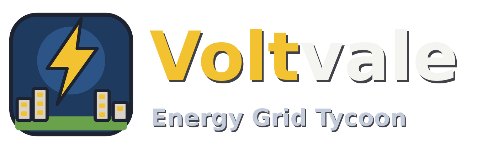
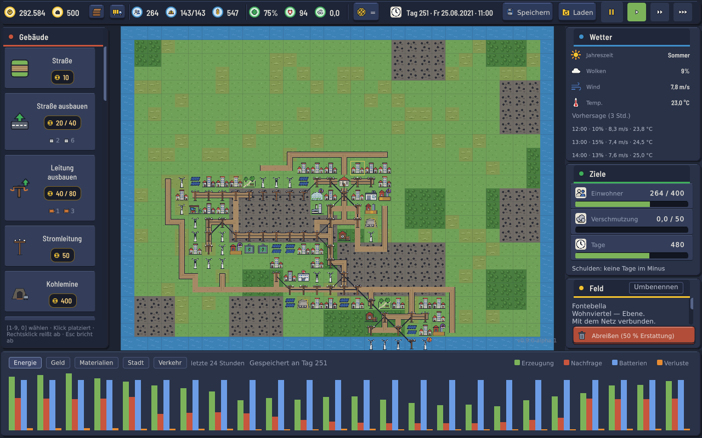
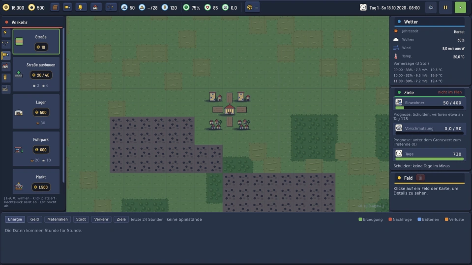

  

🇮🇹 [Italiano](README.it.md) · 🇬🇧 [English](README.md) · 🇩🇪 Deutsch · 🇫🇷 [Français](README.fr.md) · 🇪🇸 [Español](README.es.md)

# ⚡ Voltvale: Energy Grid Tycoon

**Du betreibst das Stromnetz einer wachsenden Kleinstadt.** Jede Stunde braucht die Stadt Strom: wenig in der
Nacht, viel am Abend. Baue Kraftwerke, Solarparks, Windparks und Batterien, verbinde alles mit Stromleitungen und
Straßen, finde Leute, die dort arbeiten, Schicht für Schicht, versorge alle mit Nahrung, bringe Waren und Baustoffe
mit Lkw ans Ziel, ohne den Verkehr lahmzulegen, und lass die Stadt **innerhalb von zwei Spieljahren auf 400
Einwohner** wachsen, ohne ständige Stromausfälle, ohne Schulden und ohne sie in Abgasen zu ersticken.

Ein Originalspiel von **Marco Scarlino**. Kostenlos.

## Trailer

**[▶ Trailer ansehen (1 Minute)](https://scrnetto.github.io/energy-grid-tycoon-releases/trailer/voltvale-trailer-de.mp4)** ·
auch auf [Italienisch](https://scrnetto.github.io/energy-grid-tycoon-releases/trailer/voltvale-trailer-it.mp4),
[Englisch](https://scrnetto.github.io/energy-grid-tycoon-releases/trailer/voltvale-trailer-en.mp4),
[Französisch](https://scrnetto.github.io/energy-grid-tycoon-releases/trailer/voltvale-trailer-fr.mp4) und
[Spanisch](https://scrnetto.github.io/energy-grid-tycoon-releases/trailer/voltvale-trailer-es.mp4)

> **Status: in Entwicklung (Alpha).** Das Spiel lässt sich von Anfang bis Ende spielen, aber vieles fehlt noch,
> und manches funktioniert vielleicht nicht. Jede Meldung hilft: siehe
> [Ein Problem oder eine Idee melden](#ein-problem-oder-eine-idee-melden).

## Sofort im Browser spielen

**[▶ Voltvale im Browser spielen](https://scrnetto.github.io/energy-grid-tycoon-releases/)**: nichts zu
installieren. Du brauchst einen aktuellen Browser (Chrome, Firefox, Edge, Safari) auf einem Computer mit Maus und
Tastatur oder ein Tablet: **Tippen = Klick, langes Drücken = Rechtsklick**. Klicke ins Spiel, bevor du die
Tastatur benutzt. Deine Spielstände bleiben in dem Browser, den du verwendest.

**Auch auf itch.io: [marcoscarlino.itch.io/voltvale](https://marcoscarlino.itch.io/voltvale)**. Dort kannst du im
Browser spielen, das Spiel für jedes System herunterladen und einen Kommentar hinterlassen. Spielstände aus dem
Browser auf itch.io sind von denen hier getrennt.

## Spiel herunterladen

Alle Versionen stehen auf der Seite **[Releases](../../releases)** und auf
**[itch.io](https://marcoscarlino.itch.io/voltvale)**. Lade aus der neuesten Version die Datei für dein System
herunter:

| System | Datei | So startest du es |
|---|---|---|
| **Windows** 10/11 (64 Bit) | `Voltvale-<version>-windows.zip` | Zip entpacken und `Voltvale.exe` öffnen |
| **macOS** 12 oder neuer | `Voltvale-<version>-macos.zip` | Zip entpacken und `Voltvale.app` öffnen |
| **Linux** (64 Bit) | `Voltvale-<version>-linux.zip` | Zip entpacken und `Voltvale` starten |
| **Android** 8 oder neuer (Tablet oder großes Smartphone) | `Voltvale-<version>-android.apk` | Datei auf dem Gerät öffnen und installieren (siehe unten) |

### Beim ersten Start

Das Spiel ist nicht mit einem kostenpflichtigen Zertifikat signiert, daher kann dein System warnen, dass es von
einem unbekannten Entwickler stammt. Das ist bei unabhängigen Spielen normal.

- **Windows**: Erscheint „Der Computer wurde durch Windows geschützt“, klicke auf **Weitere Informationen** und dann
  auf **Trotzdem ausführen**.
- **macOS**: Erscheint „kann nicht geöffnet werden, da der Entwickler nicht verifiziert werden kann“, mach einen
  **Rechtsklick auf die App → Öffnen** und bestätige mit **Öffnen**. Das ist nur beim ersten Mal nötig. Meldet der
  Mac, die App „ist beschädigt“, öffne das Terminal im Ordner des Zips und gib `xattr -cr Voltvale.app` ein.
- **Linux**: Startet es nicht, mach die Datei mit `chmod +x Voltvale` ausführbar.
- **Android**: Das Spiel ist nicht im Play Store. Lade die `.apk` auf das Gerät und öffne sie; beim ersten Mal
  fragt Android, ob Installationen aus dem Browser oder dem Dateimanager erlaubt werden sollen („Unbekannte Apps
  installieren“). Play Protect kann vor einer unbekannten App warnen: Wähle trotzdem installieren. Zum
  Aktualisieren installierst du die neue `.apk` über die alte. Auf dem Touchscreen: **Tippen = Klick, langes
  Drücken = Rechtsklick**, mit zwei Fingern verschieben und zoomen.

**Download prüfen (optional).** Jede Version hat eine Datei `SHA256SUMS.txt` mit dem Fingerabdruck jedes Zips.
Unter Linux mit `sha256sum -c --ignore-missing SHA256SUMS.txt`, unter macOS mit `shasum -a 256 -c SHA256SUMS.txt`.

### Systemanforderungen

- Ein Bildschirm mit mindestens 1280×800.
- Maus und Tastatur oder ein Tablet (Web- oder Android-Version).
- Etwa 200 MB freier Speicher.
- Eine beliebige Grafikkarte der letzten 10 Jahre: Auch integrierte Grafik reicht.

## So wird gespielt

Das Spiel öffnet mit dem **Startmenü**: **Neues Spiel**, oder **Fortsetzen**, um mit dem letzten Spielstand
weiterzumachen. Das Spiel beginnt am **Sonntag, 18. Oktober 2020**, um 8 Uhr und startet **pausiert**: Drücke die
**Leertaste**, damit die Zeit läuft. Bei 1× dauert eine Spielstunde eine Sekunde; du kannst auf 2× und 4×
beschleunigen. Die Jahreszeiten folgen dem Kalender: Du beginnst im Herbst, und im Winter sind die Tage kürzer und
der Himmel bewölkter. Die Leiste oben zeigt den Spieltag, den Wochentag, das Datum und die Uhrzeit, zum Beispiel
„Tag 1 · So 18.10.2020 · 08:00“.

- **Ziel**: **400 Einwohner** mit einer Verschmutzung **unter dem Grenzwert** innerhalb von **2 Jahren**.
- **Niederlage**: wenn dein Geld **30 Tage am Stück** im Minus bleibt oder die 2 Jahre abgelaufen sind.
- **Das Netz**: Jedes Gebäude muss mit dem **Rathaus** verbunden sein. **Stromleitungen** gehen vom Rathaus aus und
  verlängern es, auch diagonal. Ein Gebäude ist verbunden, wenn es das Rathaus, eine Leitung oder ein anderes
  verbundenes Gebäude berührt: Eine Gruppe nebeneinanderliegender Gebäude ist verbunden, wenn eines davon das Netz
  berührt.
- **Straßen**: Außer dem Strom muss jedes Gebäude mit einer Seite eine **mit dem Rathaus verbundene Straße**
  berühren (Stromleitungen brauchen keine). Siehe [Straßen und Verkehr](#straßen-und-verkehr).
- **Nachfrage und Strom**: Nachts verbraucht die Stadt wenig, abends gegen 19 Uhr viel. Reicht der Strom nicht,
  gibt es einen **Stromausfall**: Die Einwohner ärgern sich, und manche ziehen weg.
- **Energiequellen**:
  - die **Sonne** liefert nur tagsüber Strom, und wenig im Winter oder bei Wolken;
  - der **Wind** ändert sich von Stunde zu Stunde;
  - **Kohle** liefert immer, verschmutzt aber die Luft und verbrennt die Kohle aus den **Minen**.
- **Batterien** speichern den überschüssigen Strom und geben ihn bei Bedarf ab, zum Beispiel am Abend.
- **Überschüssiger Strom** wird an das Netz draußen verkauft, aber je mehr du anbietest, desto weniger ist er wert.
- **Verschmutzung**: Kohlekraftwerke verschmutzen die Luft, und sie klärt sich nur langsam. Ein Kraftwerk geht,
  zu viele nicht. Sie macht die Einwohner krank, und über dem Grenzwert kannst du nicht gewinnen.
- **Wachstum**: Die Stadt wächst, wenn die Einwohner **zufrieden** genug sind, in den **Wohnvierteln** Platz ist und
  genug **Nahrung** auf Vorrat liegt.

### Arbeit und Personal

Gebäude brauchen Leute, die sie betreiben.

- Etwa **56 %** der Einwohner arbeiten. Die Leiste oben zeigt, wie viele Menschen von den verfügbaren
  Arbeitskräften eine Stelle haben.
- **Kohlekraftwerke**, **Kohleminen**, **Industrie**, die Gebäude für **Nahrung**, **Krankenhäuser**, **Parks**,
  **Kühlhäuser**, **Lager** und **Pumpspeicher** brauchen Personal. **Solarparks**, **Windparks**, **Batterien**,
  Stromleitungen und Umspannwerke laufen von selbst.
- Das Fenster **Feld** zeigt, wie viele Stellen besetzt sind, zum Beispiel **Personal: 4/4**, und wie viele
  Menschen dafür nötig sind, alle Schichten eingerechnet.
- Mit zu wenig Personal produziert ein Gebäude weniger; **ganz ohne Personal steht es still** und zeigt das
  Signal **„ohne Personal“**.
- Arbeitskräfte gehen **zuerst zur Energie**, dann **zur Nahrung**, dann **zu den Krankenhäusern**, dann **zur
  Industrie**, dann **zu den Minen**, dann **zu den Diensten** (Wohnviertel und Parks). Wohnviertel funktionieren
  auch dann, wenn ihren Diensten Personal fehlt.
- **Arbeitslosigkeit** bedeutet weniger Steuereinnahmen und, wenn sie hoch ist, weniger zufriedene Einwohner.

### Arbeitszeiten und Schichten

Jedes Gebäude mit Personal hat eigene Arbeitszeiten, die das Fenster **Feld** anzeigt:

| Arbeitszeit | Gebäude | Menschen pro Stelle |
|---|---|---|
| **Immer geöffnet, 3 Schichten (6, 14, 22)** | Kohlekraftwerke, Kohleminen, Krankenhäuser, Kühlhäuser, Fuhrparks, Pumpspeicher | etwa 4: Eine Stelle, die Tag und Nacht besetzt ist, braucht drei Schichten plus Ruhetage |
| **Geöffnet 8–17, Montag bis Freitag** | Sägewerke, Steinbrüche, Zementwerke, Lager | 1 |
| **Geöffnet 8–17, jeden Tag** | Bauernhöfe, Fischkutter, Gewächshäuser, Parks, die Dienste der Wohnviertel | etwa 1,4, für die freien Tage |

- Ein Kohlekraftwerk mit allen Stellen besetzt beschäftigt etwa **17 Menschen**: Plane deine Wohnviertel danach.
- **Außerhalb der Arbeitszeit ist ein Gebäude geschlossen**: Es produziert nichts und verbraucht weder Strom noch
  Baustoffe. Das Fenster Feld sagt, wann es wieder öffnet, zum Beispiel „Geschlossen: öffnet wieder Montag um
  08:00“. Die Arbeitskräfte behalten ihre Stelle, auch während es geschlossen ist.
- Die Industrie ist **am Wochenende** geschlossen: Lege Holz und Zement für Samstag und Sonntag zurück.
- Die Nahrungsgebäude arbeiten jeden Tag, aber nur tagsüber: Bauernhöfe, Fischkutter und Gewächshäuser produzieren
  von 8 bis 17 Uhr.

### Nahrung

Die Einwohner essen jede Stunde. Der Nahrungsvorrat steht in der Leiste oben neben der Ähre und wird rot, wenn er
knapp wird.

- **Bauernhof** (Ebene): produziert je nach Jahreszeit, viel im Sommer und **nichts im Winter**.
- **Fischkutter** (Küste): fischt das ganze Jahr, bleibt aber bei zu starkem Wind im Hafen.
- **Gewächshaus** (Ebene oder Hügel): produziert das ganze Jahr, **verbraucht aber viel Strom**.
- **Kühlhaus** (Ebene): erhöht, wie viel Nahrung die Stadt lagern kann.
- **Nahrung hängt am Netz**: Die Nahrungsgebäude verbrauchen Strom. Bei einem **Stromausfall** produzieren sie
  nicht, und die Kühlhäuser verlieren einen Teil der zusätzlichen Nahrung.
- **Ist der Vorrat leer**, wird Nahrung automatisch importiert, aber das ist teuer. Mit importierter Nahrung
  verhungert die Stadt nicht, aber sie **wächst nicht**: Zum Wachsen braucht sie mindestens einen Tag eigenen
  Vorrat.
- **Geht auch das Geld aus**, kommt der Hunger, und die Einwohner ziehen weg.
- Das Fenster **Feld** zeigt, wie viel jedes Gebäude in der letzten Stunde produziert hat (zum Beispiel
  **Nahrung: 5,4/h**), wie viel Platz ein Kühlhaus hinzufügt und wie viel Strom es verbraucht.

### Zufriedenheit, Gesundheit und Steuern

- **Zufriedenheit** (der Smiley in der Leiste oben): bewegt sich langsam auf einen Wert zu, der die Summe einiger
  Faktoren ist, nämlich Stromausfälle der letzten 24 Stunden, Nahrung, Hunger, Arbeitslosigkeit, Verschmutzung,
  Gesundheit, Parks und Steuern. Fährst du mit der Maus über die Zahl, siehst du, wohin sie sich bewegt und wie stark
  jeder Faktor wiegt, zum Beispiel „Stromausfälle −5,0“ oder „Parks +3,0“. Unter 60 wächst die Stadt nicht, und unter
  35 beginnen die Leute wegzuziehen.
- **Gesundheit** (das Herz): sinkt mit Verschmutzung und Hunger. **Kranke bleiben zu Hause**, also gibt es weniger
  Arbeitskräfte, und eine ungesunde Stadt ist auch eine weniger zufriedene.
- **Krankenhaus** (Ebene): behandelt bis zu 250 Einwohner, braucht Personal und verbraucht Strom. Bei einem
  Stromausfall kann es niemanden behandeln. Ein Muss, wenn du auf Kohle setzt.
- **Park** (Ebene oder Hügel): macht die Leute zufriedener. In einer kleinen Stadt zählt er mehr: Jeder Park bringt
  +3 pro 100 Einwohner, bis zu +10.
- **Steuern**: drei Stufen, niedrig, normal und hoch, mit dem Münzknopf in der Leiste oben oder der Taste **T**.
  Hohe Steuern bringen mehr Geld, aber weniger Zufriedenheit; niedrige Steuern das Gegenteil.

### Baustoffe und Industrie

Die meisten Gebäude kosten außer Geld auch **Baustoffe**: **Holz** und **Zement**. Die Liste links zeigt sie
unter dem Preis mit kleinen Symbolen; fährst du mit der Maus über den Knopf, liest du sie ausgeschrieben.

- **Sägewerk** (nur im **Wald**, den dunkelgrünen Feldern): 7,5 Holz pro Stunde.
- **Steinbruch** (Hügel): 7,5 Stein pro Stunde.
- **Zementwerk** (Ebene): macht aus 7,5 Stein pro Stunde 7,5 Zement und verbraucht viel Strom. Ohne Stein steht es
  still und verbraucht dann auch keinen Strom.
- Die Industrie arbeitet **von 8 bis 17 Uhr, Montag bis Freitag** (siehe
  [Arbeitszeiten und Schichten](#arbeitszeiten-und-schichten)).
- Die Industrie braucht **Personal** und **Strom**. Die Arbeitskräfte gehen nach Energie, Nahrung und
  Krankenhäusern dorthin, und vor den Kohleminen.
- **Reichen die Baustoffe beim Bauen nicht**, wird der fehlende Teil sofort von außen gekauft (Holz 10, Zement 20
  pro Einheit). Man kann auch ohne Industrie spielen, aber es kostet mehr.
- Du beginnst mit 200 Holz und 200 Zement.
- Der Knopf **Vorräte** neben der Kohle in der Leiste oben öffnet ein kleines Fenster mit Kohle, Holz, Stein,
  Zement und Nahrung und zeigt, wie viel jede Stunde hinzukommt und verbraucht wird. Ein Klick daneben oder **Esc**
  schließt es.
- Das Fenster **Feld** zeigt, was ein Industriegebäude produziert und verbraucht, und „steht still: Stein fehlt“,
  wenn der Stein ausgegangen ist.

### Straßen und Verkehr

- Jedes Gebäude außer Stromleitungen muss mit einer Seite eine **mit dem Rathaus verbundene Straße** berühren. Ohne
  Straße steht es still und zeigt das Signal „ohne Straße“. Du beginnst mit vier Feldwegen rund um das Rathaus.
- Werkzeug **Straße** (Taste **R** oder der erste Knopf der Liste): klicken oder ziehen, um **Feldwege** zu legen.
  Eine Straße kann unter einer Stromleitung verlaufen, aber nicht unter anderen Gebäuden.
- Werkzeug **Straße ausbauen** (Taste **M**): **Feldweg → asphaltierte Straße → Allee**. Jede Stufe trägt mehr
  Verkehr und ist schneller, kostet aber Zement. Nach dem Ausbau bleibt das Feld ein paar Stunden eine
  **Baustelle**, mit weniger Platz für den Verkehr.
- **Pendler**: Die Arbeitskräfte fahren aus den Wohnvierteln zur Arbeit, wenn ihre Arbeitszeit beginnt, und nach
  Hause, wenn sie endet: gegen 8 und 17 Uhr bei den meisten Gebäuden, um 6, 14 und 22 Uhr bei den Schichten der
  Gebäude, die immer geöffnet sind. Am Wochenende ist die Industrie geschlossen, und auf den Straßen ist es ruhiger.
  Sind die Straßen voll, kommen alle langsamer voran: Wer zu spät kommt, leistet weniger, und die Verspätungen des
  Vortags kosten **Zufriedenheit** („Pendlerverkehr“ im Zufriedenheits-Hinweis).
- **Alleen** tragen viel Verkehr, sind aber **laut**: Sie nehmen den Wohnvierteln daneben ein wenig Zufriedenheit.
- **Verkehrskarte** (Taste **G**): färbt die Straßen nach ihrer Auslastung.
- Fenster **Verkehr** (Taste **J** oder der Lkw-Knopf oben): Personen und Waren unterwegs, durchschnittliche
  Fahrzeit, eingesetzte Lkw, die **am stärksten belasteten Straßen** (ein Klick zeigt sie im Fenster Feld) und die
  letzten 24 Stunden.
- Eine Straße abreißen: Rechtsklick, wie bei Gebäuden (die Hälfte der Kosten wird erstattet).

### Waren und Lkw

- Wer produziert (Minen, Sägewerke, Steinbrüche, Zementwerke, Bauernhöfe, Fischkutter, Gewächshäuser), legt seine
  Waren auf seinen **Hof**. **Lkw** bringen sie zum Rathaus oder zum nächsten **Lager** und von dort zu den
  **Silos** der Verbraucher: Kohlekraftwerke und Zementwerk. Das Kühlhaus dient als Lager für Nahrung.
- Das Rathaus hat **2 Lkw**; jeder **Fuhrpark** bringt **3** dazu (er braucht Personal und Strom). Bessere Straßen
  und weniger Verkehr lassen dieselben Lkw mehr transportieren.
- Reichen die Lkw nicht, erscheint die Warnung „**Zu wenige Lkw**“: Die Höfe füllen sich, und die Erzeuger stehen
  still („steht still: Hof voll“). Baue einen Fuhrpark oder ein näher gelegenes Lager.
- Ein Hof fasst nur eine begrenzte Menge: Ein voll ausgelastetes Sägewerk, ein Steinbruch oder ein Zementwerk
  kann ihn vor dem Abend füllen, wenn die Lkw nicht nachkommen.
- **Nahrung verdirbt** auf jeder Fahrt ein wenig: Je weiter der Bauernhof entfernt ist, desto mehr geht verloren.
- Das Fenster **Feld** zeigt Hof, Silo und Entfernung zum Lager; **Vorräte** zeigt, was auf den Höfen wartet.

### Leitungsverluste

- Ein Teil des Stroms eines Kraftwerks geht auf den Leitungen bis zum nächsten **Knoten** verloren: dem
  **Rathaus** oder einem **Umspannwerk** (in der Liste baubar). Je weiter das Kraftwerk entfernt ist, desto mehr
  verliert es; das Fenster Feld zeigt, wie viel.
- Werkzeug **Leitung ausbauen** (Taste **L**): Leitungen gehen von Stufe **I** auf **II** und **III** und verlieren
  weniger, kosten aber **Kupfer**, das von außen gekauft wird.
- Das Diagramm **Energie** unten hat einen Balken für die Verluste.

### Minen und Seen

- Jedes Kohlevorkommen hat seine eigene **Reserve**, von Feld zu Feld verschieden: Das Fenster Feld einer Mine
  zeigt, wie viel noch übrig ist und für wie viele Tage. Ist sie fast leer, fördert die Mine weniger; es kommen die
  Warnungen „Bergwerk fast erschöpft“ und „Bergwerk erschöpft“.
- Drei Tage nach der Erschöpfung verschwindet die Mine, und an ihrer Stelle entsteht ein **See**. Ein See:
  - kühlt die **Kohlekraftwerke** in der Nähe, die dadurch etwas mehr erzeugen;
  - freut die **Wohnviertel** daneben, wie ein Park;
  - bietet Platz für **Fischkutter**;
  - ermöglicht den **Pumpspeicher**, eine große Batterie, die nur neben einem See gebaut werden kann.

### Namen

- Straßen, Wohnviertel, Krankenhäuser und Parks haben einen **Namen**, den das Fenster Feld oben zeigt, zum
  Beispiel „Voltastraße“. Eine Straße behält ihren Namen auf ihrem ganzen geraden Abschnitt.
- Der Knopf **Umbenennen** im Fenster Feld ändert ihn; leer gelassen kehrt der automatische Name zurück.

### Diagramme

Das Fenster unten zeigt die **letzten 24 Stunden**, eine Spalte pro Stunde, auf fünf Registerkarten. Ein Klick auf
eine Registerkarte wechselt dorthin (das Spiel merkt sich deine Wahl); fährst du mit der Maus über eine Spalte,
liest du die genauen Werte dieser Stunde.

- **Energie**: Erzeugung, Nachfrage, Batterien und Leitungsverluste.
- **Geld**: Einnahmen über der Null, Ausgaben darunter, und der Kontostand.
- **Materialien**: wie viel von jedem Material erzeugt und verbraucht wird, und der Vorrat; das Material wählst du
  mit den Knöpfen neben dem Diagramm.
- **Stadt**: erzeugte und verzehrte Nahrung, der Nahrungsvorrat, Zufriedenheit und Gesundheit.
- **Verkehr**: Menschen auf dem Weg zur Arbeit und nach Hause, Lkw unterwegs und die Straßenauslastung.

Nach dem Laden eines Spielstands aus einer früheren Version starten die Diagramme leer und füllen sich Stunde für
Stunde.

### Steuerung

Fahr mit der Maus über ein Symbol oder einen Knopf: Ein Hinweis erklärt, was es ist. Bleibst du über einem Gebäude
auf der Karte stehen, siehst du seinen Zustand und wie viel Strom es erzeugt oder verbraucht.

| Steuerung | Was sie tut |
|---|---|
| Tasten **1–9** und **0** | Wählen, was gebaut wird: Stromleitung, Kohlemine, Kohlekraftwerk, Solarpark, Windpark, Batterie, Wohnviertel, Bauernhof, Fischkutter, Gewächshaus. Die übrigen Gebäude (Kühlhaus, Park, Krankenhaus, Industrie, Lager, Fuhrpark, Umspannwerk, Pumpspeicher) stehen in der Liste links |
| **Linksklick** | Setzt das gewählte Gebäude. Ohne Auswahl wählt er ein Feld und zeigt dessen Details |
| **Rechtsklick** (auf dem Tablet: langes Drücken) | Mit gewähltem Gebäude: hebt die Auswahl auf. Ohne Auswahl: fragt nach, ob abgerissen werden soll (die Hälfte der Kosten wird erstattet) |
| **Esc** | Hebt die Auswahl auf; gibt es nichts aufzuheben, öffnet es das **Pausenmenü** (Weiter, Speichern unter…, Schnellspeichern, Spiel laden, Speichern und zum Menü, Neues Spiel, Sprache) |
| **F11** | Vollbild / Fenster |
| **Leertaste** oder der Knopf ▶/❚❚ | Pause / weiter |
| **F** oder die Pfeilknöpfe | Geschwindigkeit 1×, 2×, 4× |
| **V** | Um genau eine Stunde vorspulen |
| **T** oder der Münzknopf | Steuern niedrig, normal, hoch |
| **WASD** oder **Pfeiltasten**, mittlere Maustaste | Ansicht verschieben |
| **Mausrad** | Zoom |
| Knopf **Vorräte** (oben) | Zeigt die Vorräte an Kohle, Holz, Stein, Zement und Nahrung |
| **Speichern** / **Laden** (oben) | **Speichern** legt einen neuen Spielstand mit dem Namen „Tag N“ an; **Laden** setzt den neuesten Spielstand fort. Das Spiel speichert außerdem jeden Tag von selbst |
| **F5** / **F9** | Schnellspeichern / Schnellspeicherstand laden |
| **R** | Werkzeug **Straße**: klicken oder ziehen, um Feldwege zu legen |
| **M** | Werkzeug **Straße ausbauen**: Feldweg → asphaltierte Straße → Allee |
| **L** | Werkzeug **Leitung ausbauen**: Leitungen von Stufe I → II → III |
| **G** | Verkehrskarte |
| **J** oder der Knopf **Verkehr** (oben) | Fenster Verkehr: Personen, Waren, am stärksten belastete Straßen |
| Knopf **Umbenennen** (im Fenster Feld) | Benennt eine Straße, ein Wohnviertel, ein Krankenhaus oder einen Park um |
| Registerkarten des Diagramms (unten) | Energie, Geld, Materialien, Stadt, Verkehr |

### Sprachen

Das Spiel gibt es auf **Italienisch, Englisch, Deutsch, Französisch und Spanisch**. Im Startmenü oder im
Pausenmenü wechselt der Punkt **Sprache** jederzeit, ohne Neustart; deine Wahl wird gespeichert. Beim ersten Start
verwendet das Spiel die Sprache deines Systems, wenn es eine dieser fünf ist, sonst Englisch. In der Web-Version
kannst du eine Sprache direkt öffnen, indem du `?lingua=de` (oder `it`, `en`, `fr`, `es`) an die Adresse anhängst.

### Signale an Gebäuden

- **Gezogener Stecker** (weiß-roter Kreis): Das Gebäude ist nicht mit dem Netz verbunden.
- **Durchgestrichener Blitz** (gelber Kreis): Es ist verbunden, bekommt aber keinen Strom (Stromausfall), oder ein
  Kohlekraftwerk steht still, weil die Kohle ausgegangen ist. Ein Gewächshaus oder Kühlhaus ohne Strom arbeitet
  nicht.
- **Durchgestrichener Schutzhelm** (hellblauer Kreis): **ohne Personal**, das Gebäude steht still. Baue mehr
  Wohnviertel oder mach Arbeitskräfte frei.
- **Unterbrochene Straße** (orangefarbener Kreis): **ohne Straße**, keine mit dem Rathaus verbundene Straße
  erreicht es.
- **Kistenstapel** (violetter Kreis): **Hof voll**, die Lkw kommen mit dem Abtransport nicht nach.
- **Mit Brettern vernagelte Mine**: Die Mine ist **erschöpft** und wird in ein paar Tagen zu einem See.
- **Licht in der Nacht**: Bei Dunkelheit machen Wohnviertel und Rathaus Licht. Ein Gebäude ohne Strom bleibt
  dunkel: Ein dunkles Wohnviertel in der Nacht ist ein Warnzeichen.

### Tipps für das erste Spiel

1. Pausiere und sieh dir die Karte an: **Hügel** eignen sich für Windparks, und auf die dunklen **Kohlevorkommen**
   kommen die Minen.
2. Zieh eine **Stromleitung** vom Rathaus dorthin, wo du bauen willst, mit einer **Straße** (Taste **R**)
   daneben: Jedes Gebäude muss eine berühren.
3. Beginne mit etwas **Solar und Wind** und einer **Batterie** für den Abend.
4. Baue nicht zu viele Kohlekraftwerke auf einmal: Jedes braucht etwa **17 Menschen** in drei Schichten, und die
   Stadt ist noch klein. Solar- und Windparks brauchen kein Personal.
5. Baue **Wohnviertel**, solange die Erzeugung mit der Nachfrage mithält.
6. Setze früh einen **Bauernhof** und denk an den Winter: Im Winter stehen die Bauernhöfe still, also brauchst du
   einen Vorrat, einen Fischkutter oder ein Gewächshaus.
7. Setze im ersten Monat ein **Sägewerk** in den Wald und einen **Steinbruch** auf einen Hügel; nimm ein
   **Zementwerk** dazu, wenn du etwas Geld übrig hast. Baustoffe jedes Mal von außen zu kaufen, summiert sich. Die
   Industrie ruht am Wochenende: Halte einen Vorrat.
8. Ein früher **Park** hebt die Zufriedenheit, solange die Stadt klein ist. Baust du Kohlekraftwerke, plane ein
   **Krankenhaus** ein.
9. Behalte das Diagramm **Energie** unten im Auge: Steigt die rote Linie (Nachfrage) über die grüne (Erzeugung),
   kommt gleich ein Stromausfall.
10. Erscheint „Zu wenige Lkw“, baue einen **Fuhrpark**. Wenn die Stadt wächst, sieh auf die **Verkehrskarte** (G)
    und baue die am stärksten belasteten Straßen aus (M); setze Alleen nicht direkt neben Wohnviertel.
11. Halte Kraftwerke nahe am Rathaus oder an einem **Umspannwerk**: Weit weg verlieren sie Strom.

## Spielstände

- **Speichern unter…** (Pausenmenü): Wähle einen Namen für den Spielstand oder überschreibe einen, den du schon
  angelegt hast. Bis zu 50 benannte Spielstände pro Spiel.
- **Schnellspeichern**: **F5** speichert, **F9** kehrt dorthin zurück. Es gibt einen pro Spiel, der jedes Mal
  überschrieben wird. Auf dem Tablet steht er im Pausenmenü.
- **Automatische Spielstände**: einer zu Beginn jedes Spieltags; die letzten drei bleiben erhalten.
- **Spiel laden** (Startmenü und Pausenmenü): alle deine Spielstände, nach Spiel gruppiert, mit Tag, Geld,
  Einwohnern und Datum. Hier kannst du **laden**, einen benannten Spielstand **umbenennen** oder einen **löschen**.
- **Fortsetzen** (Startmenü) setzt den neuesten Spielstand fort, egal welcher Art.

## Wo die Spielstände liegen

Die Spielstände bleiben auf deinem Computer, oder bei der Web-Version in deinem Browser, und das Spiel schickt
nichts ins Internet.

- **Windows**: `%USERPROFILE%\AppData\LocalLow\Marco Scarlino\Voltvale\salvataggi`
- **macOS**: `~/Library/Application Support/Marco Scarlino/Voltvale/salvataggi`
- **Linux**: `~/.config/unity3d/Marco Scarlino/Voltvale/salvataggi`
- **Android**: in der App; sie werden gelöscht, wenn du sie deinstallierst.

**Kommst du von einer früheren Version?** Beim ersten Start der 0.3.0 **kopiert** das Spiel deine Spielstände aus
dem alten Ordner „Energy Grid Tycoon“ (gleicher Pfad, mit „Energy Grid Tycoon“ statt „Voltvale“). Der alte Ordner
bleibt, wo er ist. Die **Sprache** musst du einmal neu wählen.

**Ab 0.4.0** haben die Spielstände ein neues Format. Spielstände früherer Versionen lassen sich trotzdem laden: Die
Stadt startet mit dem anfänglichen Nahrungsvorrat. Ein Spielstand der 0.4.0 öffnet sich nicht in früheren
Versionen.

**Ab 0.5.0** ändert sich das Format erneut: Steuern und Gesundheit. Spielstände früherer Versionen laden mit
normalen Steuern und der anfänglichen Gesundheit. Ein Spielstand der 0.5.0 öffnet sich nicht in früheren Versionen.

**Ab 0.6.0** ändert sich das Format noch einmal: Baustoffe. Spielstände früherer Versionen laden mit dem
anfänglichen Holz und Zement, und auf der Karte erscheinen die Wälder; Gebäude, die nun im Wald stehen, bleiben, wo
sie sind. Ein Spielstand der 0.6.0 öffnet sich nicht in früheren Versionen.

**Ab 0.7.0** liegen die Spielstände in einem Ordner pro Spiel. Beim ersten Start macht das Spiel aus den
Spielständen der vorherigen Version (dem Spielstand und dem automatischen) ein Spiel, das du unter **Spiel laden**
und mit **Fortsetzen** findest; die Originaldateien bleiben im Unterordner `vecchi`. Frühere Versionen sehen die
Spielstände der 0.7.0 nicht.

**Ab 0.8.0** ändert sich das Format erneut: Straßen, Waren, Verkehr, Leitungen, Minen und Namen. Spielstände
früherer Versionen lassen sich laden: Das Spiel legt selbst die Feldwege rund um das Rathaus und einen Feldweg zu
jedem Gebäude an; Kohlekraftwerke starten mit vollem Silo, Minen mit voller Reserve, und Straßen, Wohnviertel,
Krankenhäuser und Parks bekommen einen Namen. Ein Spielstand der 0.8.0 öffnet sich nicht in früheren Versionen.

**0.9.0** verwendet dasselbe Format wie 0.8.0: Deine Spiele aus der 0.8.0 laufen einfach weiter, mit den neuen
Arbeitszeiten.

Spielstände einer Alpha-Version funktionieren in der nächsten vielleicht nicht: Das [Changelog](CHANGELOG.md) sagt
es, wenn das passiert.

## Demnächst

Was schon geplant ist, ungefähr in dieser Reihenfolge. Pläne können sich ändern.

- **Ereignisprotokoll**: ein Fenster, das alle Warnungen und Ereignisse festhält, oben die Probleme, die noch
  offen sind; ein Klick zeigt, wo es passiert ist.
- **Löhne und Erfahrung**: Löhne, Rechnungen, Essen und Miete; wer an derselben Stelle bleibt, wird besser und
  verdient mehr.
- **Bautrupps und Bauhof**: Bauen wird Zeit brauchen. Die Arbeit erledigen Trupps des Rathauses und später der
  Bauhöfe, die mit deinen Baustoffen auch reparieren, was sich abnutzt.
- **Öl, Gas und Wärme**: neue Energiequellen, und Heizung im Winter.
- **Wasser und Abfall**: Wasserwerke, Kläranlagen und Deponien für eine größere Stadt.
- **Bildung und Forschung**: Schulen und Technologien zum Entdecken, die neue Gebäude freischalten.
- **Neue Karten, und später**: in jedem Spiel eine andere Karte, größere Karten, eine Minikarte; dann eine
  isometrische Ansicht und mehrere miteinander verbundene Städte.

## Bekannte Probleme

- Die Versionen für **Windows** und **macOS** wurden noch nicht auf echten Computern getestet: Wenn etwas nicht
  klappt, [sag Bescheid](#ein-problem-oder-eine-idee-melden).
- Die **Android**-Version wird von Hand installiert, außerhalb des Play Store.
- In der **Web**-Version liegen die Spielstände im Browser: Löschst du die Daten der Seite, sind sie weg.
- Es ist eine **Alpha**: Das Gleichgewicht des Spiels (Kosten, Produktion, Wachstum, Verkehr) ändert sich noch von
  Version zu Version. Mit den neuen Arbeitszeiten produziert die Industrie in wenigen Stunden viel: Wenn ihre Höfe
  voll werden, baue früh einen Fuhrpark.
- Die Übersetzungen ins Deutsche, Französische und Spanische hat noch keine Person mit dieser Muttersprache
  durchgesehen: Meldungen zu Fehlern sind willkommen.

## Versionen

Die Versionen folgen der [semantischen Versionierung](https://semver.org/lang/de/) in drei Phasen:

| Phase | Beispiel | Was das bedeutet |
|---|---|---|
| **Alpha** | `0.3.0-alpha.1` | Das Spiel ändert sich von Version zu Version stark; Teile fehlen; es kann Fehler geben und Spielstände, die nicht übernommen werden |
| **Beta** | `0.9.0-beta.1` | Alle Hauptteile sind da; Fehler und Spielgleichgewicht werden verfeinert |
| **Stabil** | `1.0.0` | Die erste vollständige Version. Danach `1.0.1` für Korrekturen und `1.1.0` für Neuheiten |

Alpha- und Beta-Versionen sind auf GitHub als **Pre-Release** markiert. Was sich in jeder Version ändert, steht im
**[CHANGELOG](CHANGELOG.md)** und auf der Seite jeder Release.

## Ein Problem oder eine Idee melden

Öffne eine Meldung auf der Seite **[Issues](../../issues/new/choose)** und wähle:
- **Problema** (Problem): Etwas funktioniert nicht. Schreib, was du gerade gemacht hast, was du erwartet hast und
  welche Version des Spiels du hast.
- **Idea** (Idee): ein Vorschlag, um das Spiel zu verbessern.

Du brauchst ein GitHub-Konto, das kostenlos ist. Wenn du keins hast, schreib Marco gern direkt.

## Lizenz

Voltvale ist **kostenlos**: Du kannst es herunterladen und so viel spielen, wie du willst. Du darfst es **nicht**
weiterverbreiten, verkaufen oder verändern: Wenn jemand anderes spielen soll, schick den Link zu dieser Seite. Die
Einzelheiten stehen in [LICENSE.md](LICENSE.md) (auf Italienisch, mit einer Zusammenfassung auf Englisch).

## Credits

Entworfen und umgesetzt von **Marco Scarlino**, mit Unity und mit Hilfe von KI-Werkzeugen für Code, Grafik und
Übersetzungen.

Schriften: Barlow Semi Condensed (SIL Open Font License 1.1), DejaVu Sans (Bitstream-Vera-Lizenz).
