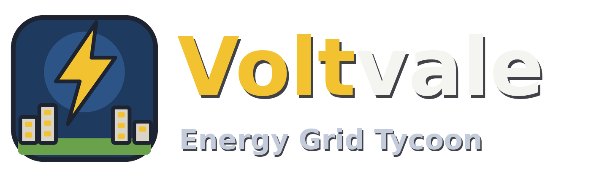
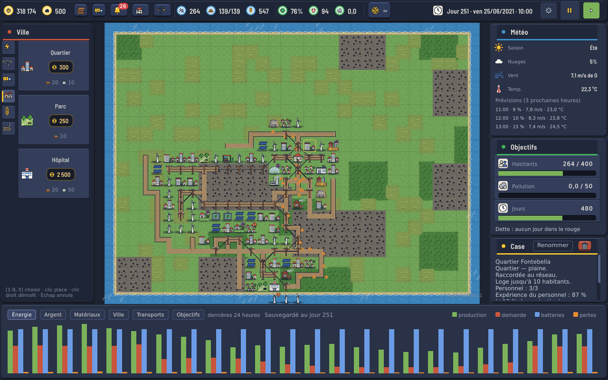
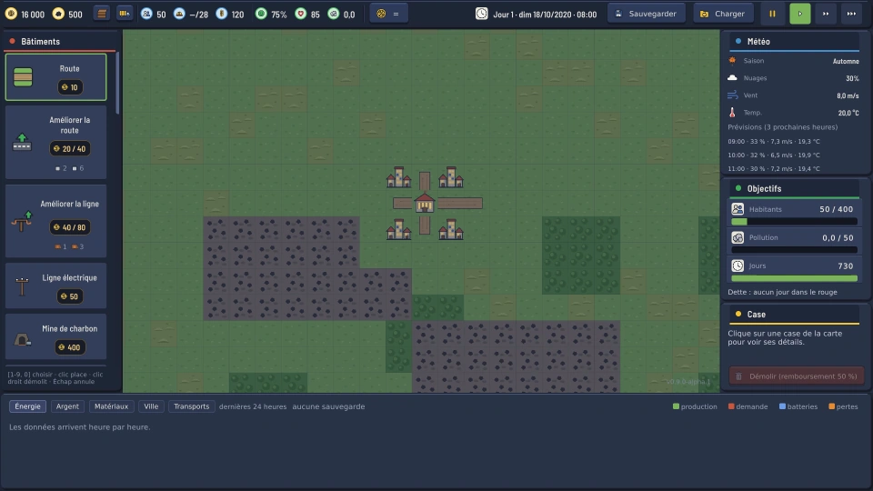

  

🇮🇹 [Italiano](README.it.md) · 🇬🇧 [English](README.md) · 🇩🇪 [Deutsch](README.de.md) · 🇫🇷 Français · 🇪🇸 [Español](README.es.md)

# ⚡ Voltvale: Energy Grid Tycoon

**Tu gères le réseau électrique d'une petite ville qui grandit.** Chaque heure, la ville a besoin d'énergie : un
peu la nuit, beaucoup le soir. Construis des centrales, des centrales solaires, des parcs éoliens et des batteries,
relie le tout par des lignes électriques et des routes, trouve des gens pour y travailler, équipe après équipe,
nourris tout le monde, transporte marchandises et matériaux en camion sans bloquer la circulation, et fais grandir
la ville jusqu'à **400 habitants en deux ans de jeu**, sans pannes à répétition, sans dettes et sans l'étouffer
sous la pollution.

Un jeu original de **Marco Scarlino**. Gratuit.

## Bande-annonce

**[▶ Voir la bande-annonce (1 minute)](https://scrnetto.github.io/energy-grid-tycoon-releases/trailer/voltvale-trailer-fr.mp4)** ·
aussi en [italien](https://scrnetto.github.io/energy-grid-tycoon-releases/trailer/voltvale-trailer-it.mp4),
[anglais](https://scrnetto.github.io/energy-grid-tycoon-releases/trailer/voltvale-trailer-en.mp4),
[allemand](https://scrnetto.github.io/energy-grid-tycoon-releases/trailer/voltvale-trailer-de.mp4) et
[espagnol](https://scrnetto.github.io/energy-grid-tycoon-releases/trailer/voltvale-trailer-es.mp4)

> **État : en développement (alpha).** On peut jouer du début à la fin, mais il manque encore beaucoup de choses et
> certaines peuvent ne pas marcher. Chaque signalement aide : voir
> [Signaler un problème ou une idée](#signaler-un-problème-ou-une-idée).

## Jouer tout de suite dans le navigateur

**[▶ Jouer à Voltvale dans le navigateur](https://scrnetto.github.io/energy-grid-tycoon-releases/)** : rien à
installer. Il faut un navigateur récent (Chrome, Firefox, Edge, Safari) sur un ordinateur avec souris et clavier, ou
une tablette : **toucher = clic, appui long = clic droit**. Clique sur le jeu avant d'utiliser le clavier. Tes
sauvegardes restent dans le navigateur que tu utilises.
Sur un téléphone tenu **à l'horizontale**, le jeu passe à une disposition faite pour les téléphones (encore en
essai : voir [Problèmes connus](#problèmes-connus)).

**Aussi sur itch.io : [marcoscarlino.itch.io/voltvale](https://marcoscarlino.itch.io/voltvale)**, où tu peux jouer
dans le navigateur, télécharger le jeu pour chaque système et laisser un commentaire. Les sauvegardes faites dans
le navigateur sur itch.io sont séparées de celles faites ici.

## Télécharger le jeu

Toutes les versions sont sur la page **[Releases](../../releases)** et sur
**[itch.io](https://marcoscarlino.itch.io/voltvale)**. Télécharge le fichier de ton système dans la dernière
version :

| Système | Fichier | Comment le lancer |
|---|---|---|
| **Windows** 10/11 (64 bits) | `Voltvale-<version>-windows.zip` | Extrais le zip et ouvre `Voltvale.exe` |
| **macOS** 12 ou plus récent | `Voltvale-<version>-macos.zip` | Extrais le zip et ouvre `Voltvale.app` |
| **Linux** (64 bits) | `Voltvale-<version>-linux.zip` | Extrais le zip et lance `Voltvale` |
| **Android** 8 ou plus récent (tablette ou téléphone) | `Voltvale-<version>-android.apk` | Ouvre le fichier sur l'appareil et installe-le (voir plus bas) |

### Au premier lancement

Le jeu n'est pas signé avec un certificat payant : ton système peut donc t'avertir qu'il vient d'un développeur
inconnu. C'est normal pour les jeux indépendants.

- **Windows** : si « Windows a protégé votre ordinateur » s'affiche, clique sur **Informations complémentaires**,
  puis sur **Exécuter quand même**.
- **macOS** : si le message dit que l'app « ne peut pas être ouverte car le développeur ne peut pas être vérifié »,
  fais un **clic droit sur l'app → Ouvrir**, puis confirme avec **Ouvrir**. Il suffit de le faire une fois. Si le
  Mac dit que l'app « est endommagée », ouvre le Terminal dans le dossier du zip et tape `xattr -cr Voltvale.app`.
- **Linux** : s'il ne démarre pas, rends le fichier exécutable avec `chmod +x Voltvale`.
- **Android** : le jeu n'est pas sur le Play Store. Télécharge l'`.apk` sur l'appareil et ouvre-le ; la première
  fois, Android demande d'autoriser les installations depuis le navigateur ou le gestionnaire de fichiers
  (« Installer des applis inconnues »). Play Protect peut signaler une application inconnue : choisis de
  l'installer quand même. Pour mettre à jour, installe le nouvel `.apk` par-dessus l'ancien. Sur écran tactile :
  **toucher = clic, appui long = clic droit**, deux doigts pour déplacer la carte et pour zoomer.

**Vérifier le téléchargement (facultatif).** Chaque version a un fichier `SHA256SUMS.txt` avec l'empreinte de
chaque zip. Sous Linux, lance `sha256sum -c --ignore-missing SHA256SUMS.txt`, sous macOS
`shasum -a 256 -c SHA256SUMS.txt`.

### Configuration requise

- Un écran d'au moins 1280×800, ou un téléphone tenu à l'horizontale.
- Souris et clavier, ou un écran tactile (tablette ou téléphone, version web ou Android).
- Environ 200 Mo d'espace libre.
- N'importe quelle carte graphique des 10 dernières années : les puces intégrées suffisent.

## Comment jouer

Le jeu s'ouvre sur le **menu de départ** : **Nouvelle partie**, ou **Continuer** pour reprendre ta dernière
sauvegarde. La partie commence le **dimanche 18 octobre 2020** à 8 h et démarre **en pause** : appuie sur
**Espace** pour faire avancer le temps. À la vitesse 1×, une heure de jeu dure une seconde, et tu peux accélérer à
2× et 4×. Les saisons suivent le calendrier : tu commences en automne, et en hiver les journées sont plus courtes
et le ciel plus couvert. La barre du haut indique le jour de la partie, le jour de la semaine, la date et l'heure,
par exemple « Jour 1 · dim 18/10/2020 · 08:00 ».

- **Objectif** : atteindre **400 habitants** avec une pollution **sous le seuil** en **2 ans**.
- **Défaite** : si ton argent reste dans le rouge **30 jours d'affilée**, ou si les 2 ans s'écoulent.
- **Le réseau** : chaque bâtiment doit être raccordé à la **mairie**. Les **lignes électriques** partent de la
  mairie et la prolongent, y compris en diagonale. Un bâtiment est raccordé s'il touche la mairie, une ligne ou un
  autre bâtiment raccordé : un groupe de bâtiments accolés est raccordé si l'un d'eux touche le réseau.
- **Les routes** : en plus du courant, chaque bâtiment doit toucher par un côté une **route reliée à la mairie**
  (les lignes électriques n'en ont pas besoin). Voir [Routes et trafic](#routes-et-trafic).
- **Demande et énergie** : la ville consomme peu la nuit et beaucoup le soir, vers 19 h. S'il n'y a pas assez
  d'énergie, c'est la **panne** : les habitants se fâchent et certains s'en vont.
- **Les sources** :
  - le **soleil** ne produit que le jour, et peu en hiver ou par temps couvert ;
  - le **vent** change de force et de direction d'heure en heure (le panneau Météo dit d'où il souffle) ; un parc
    éolien **sous le vent** d'un autre, à quelques cases, produit moins (le « sillage » des éoliennes, jusqu'à 40 %
    de moins) ;
  - le **charbon** produit toujours, mais il pollue et brûle le charbon extrait par les **mines**.
- **Les batteries** stockent l'énergie en trop et la restituent quand il le faut, par exemple le soir.
- **Le surplus** est vendu au réseau extérieur, mais plus tu en proposes, moins il vaut.
- **Pollution** : les centrales à charbon polluent et l'air se purifie lentement. Une centrale, ça passe ; trop,
  non. La pollution rend les habitants malades, et au-dessus du seuil tu ne peux pas gagner.
- **Croissance** : la ville grandit si les habitants sont assez **heureux**, s'il reste de la place dans les
  **quartiers** et s'il y a assez de **nourriture** en réserve.

### Travail et personnel

Les bâtiments ont besoin de gens pour les faire tourner.

- Environ **56 %** des habitants travaillent. La barre du haut montre combien de personnes ont un emploi par
  rapport à la main-d'œuvre disponible.
- Les **centrales à charbon**, les **mines de charbon**, les **industries**, les bâtiments de **nourriture**, les
  **hôpitaux**, les **parcs**, les **entrepôts frigorifiques**, les **entrepôts** et les **stations de pompage** ont
  besoin de personnel. Les **centrales solaires**, les **parcs éoliens**, les **batteries**, les lignes et les
  transformateurs fonctionnent tout seuls.
- Le panneau **Case** montre combien de postes sont pourvus, par exemple **Personnel : 4/4**, et combien de
  personnes il faut pour cela, toutes équipes comprises.
- Avec trop peu de personnel, un bâtiment produit moins ; **sans personne, il s'arrête** et affiche le signal
  **« sans personnel »**.
- Les travailleurs vont **d'abord à l'énergie**, puis **à la nourriture**, puis **aux hôpitaux**, puis **aux
  industries**, puis **aux mines**, puis **aux services** (quartiers et parcs). Les quartiers fonctionnent même quand
  leurs services manquent de personnel.
- Le **chômage** coûte cher : ceux qui ne travaillent pas ne paient pas d'impôt sur le revenu et reçoivent une
  allocation de la ville ; s'il est élevé, les habitants sont moins heureux.

### Horaires et équipes

Chaque bâtiment avec du personnel a ses propres horaires, affichés dans le panneau **Case** :

| Horaire | Bâtiments | Personnes par poste |
|---|---|---|
| **Toujours ouvert, 3 équipes (6, 14, 22)** | centrales à charbon, mines de charbon, hôpitaux, entrepôts frigorifiques, parcs de camions, stations de pompage | environ 4 : un poste tenu jour et nuit demande trois équipes plus les jours de repos |
| **Ouvert 8–17, du lundi au vendredi** | scieries, carrières, cimenteries, entrepôts | 1 |
| **Ouvert 8–17, tous les jours** | fermes, bateaux de pêche, serres, parcs, les services des quartiers | environ 1,4, pour les jours de repos |

- Une centrale à charbon avec tous ses postes pourvus emploie environ **17 personnes** : prévois tes quartiers en
  conséquence.
- **En dehors de ses horaires, un bâtiment est fermé** : il ne produit rien et ne consomme ni énergie ni matériaux.
  Le panneau Case dit quand il rouvre, par exemple « Fermé : rouvre lundi à 08:00 ». Les travailleurs gardent leur
  emploi pendant la fermeture.
- Les industries sont fermées **le week-end** : garde du bois et du ciment de côté pour le samedi et le dimanche.
- Les bâtiments de nourriture travaillent tous les jours, mais seulement le jour : fermes, bateaux de pêche et serres
  produisent de 8 h à 17 h.

### Nourriture

Les habitants mangent toutes les heures. Les réserves de nourriture sont dans la barre du haut, à côté de l'épi de
blé, et passent au rouge quand elles s'épuisent.

- **Ferme** (plaine) : produit selon la saison, beaucoup en été et **rien en hiver**.
- **Bateau de pêche** (côte) : pêche toute l'année, mais reste au port quand le vent est trop fort.
- **Serre** (plaine ou colline) : produit toute l'année, mais **consomme beaucoup d'électricité**.
- **Entrepôt frigorifique** (plaine) : augmente la quantité de nourriture que la ville peut garder.
- **La nourriture dépend du réseau** : les bâtiments de nourriture consomment de l'électricité. Pendant une
  **panne**, ils ne produisent pas et les entrepôts frigorifiques perdent une partie de la nourriture en plus.
- **Si les réserves sont vides**, la nourriture est importée automatiquement, mais elle coûte cher. Avec la
  nourriture importée, la ville ne meurt pas de faim, mais elle **ne grandit pas** : pour grandir, il lui faut au
  moins une journée de réserves à elle.
- **Si l'argent manque aussi**, c'est la famine, et les habitants s'en vont.
- Le panneau **Case** montre combien chaque bâtiment a produit dans la dernière heure (par exemple
  **Nourriture : 5,4/h**), combien de place ajoute un entrepôt frigorifique et combien d'électricité il consomme.

### Bonheur, santé et impôts

- **Bonheur** (le smiley dans la barre du haut) : il évolue lentement vers une valeur qui est la somme de quelques
  facteurs, à savoir les pannes des dernières 24 heures, la nourriture, la faim, le chômage, la pollution, la santé,
  les parcs, les impôts et le budget du ménage. En passant la souris sur le chiffre, tu vois vers quelle valeur il va et combien pèse
  chaque facteur, par exemple « Pannes −5,0 » ou « Parcs +3,0 ». Sous 60, la ville ne grandit pas, et sous 35 les
  gens commencent à partir.
- **Santé** (le cœur) : baisse avec la pollution et la faim. **Les malades restent chez eux** : il y a donc moins
  de travailleurs, et une ville en mauvaise santé est aussi une ville moins heureuse.
- **Hôpital** (plaine) : soigne jusqu'à 250 habitants, a besoin de personnel et consomme de l'électricité. Pendant
  une panne, il ne soigne personne. Indispensable si tu mises sur le charbon.
- **Parc** (plaine ou colline) : rend les gens plus heureux. Il compte davantage dans une petite ville : chaque parc
  vaut +3 pour 100 habitants, jusqu'à +10.
- **Impôts** : c'est l'impôt sur le revenu de ceux qui travaillent, sur trois niveaux, bas, normaux et élevés, avec
  le bouton à la pièce dans la barre du haut ou la touche **T**. Des impôts élevés rapportent plus d'argent mais
  moins de bonheur ; des impôts bas font l'inverse.

### Salaires, ménages et factures

- La ville paie un **salaire** pour chaque poste occupé, un peu plus pour les équipes de nuit.
- Le personnel prend de l'**expérience** : ceux qui restent au même poste produisent jusqu'à **15 %** de plus, mais
  gagnent aussi plus. Quand le personnel change, l'expérience baisse : garder ses travailleurs est payant. Le
  panneau Case montre l'expérience et les salaires de chaque bâtiment.
- Les ménages paient à la ville l'**impôt sur le revenu**, la **facture d'électricité** des quartiers, la
  **nourriture** et le **loyer**. Ceux qui n'ont pas de travail reçoivent une **allocation chômage**. Les ménages ont
  aussi d'autres revenus, comme les retraites et le travail hors de la ville.
- Panneau **Ménages** (touche **H** ou le bouton en haut) : revenus et dépenses des ménages sur les dernières 24
  heures, ce qui reste à chaque habitant par jour et le salaire moyen. C'est là que tu choisis le **tarif de
  l'énergie** : bas, normal ou élevé. Un tarif élevé rapporte plus à la ville, mais laisse moins aux ménages.
- Ce qui reste aux ménages compte pour le bonheur (« Budget du ménage » dans l'info-bulle du bonheur).

### Matériaux et industries

La plupart des bâtiments coûtent, en plus de l'argent, des **matériaux** : du **bois** et du **ciment**. La liste
de gauche les affiche sous le prix, avec de petites icônes ; en passant la souris sur le bouton, tu les lis en
entier.

- **Scierie** (seulement dans la **forêt**, les cases vert foncé) : 7,5 de bois par heure.
- **Carrière** (collines) : 7,5 de pierre par heure.
- **Cimenterie** (plaine) : transforme 7,5 de pierre en 7,5 de ciment par heure et consomme beaucoup
  d'électricité. Sans pierre, elle s'arrête et cesse aussi de consommer de l'électricité.
- Les industries travaillent **de 8 h à 17 h, du lundi au vendredi** (voir [Horaires et équipes](#horaires-et-équipes)).
- Les industries ont besoin de **personnel** et d'**électricité**. Les travailleurs y vont après l'énergie, la
  nourriture et les hôpitaux, et avant les mines de charbon.
- **Si les matériaux ne suffisent pas** quand tu construis, la partie qui manque est achetée tout de suite à
  l'extérieur (bois 10, ciment 20 l'unité). On peut jouer sans industries, mais cela coûte plus cher.
- Tu commences avec 200 de bois et 200 de ciment.
- Le bouton **Stocks**, à côté du charbon dans la barre du haut, ouvre un petit panneau avec le charbon, le bois,
  la pierre, le ciment et la nourriture, et ce qui entre et sort chaque heure. Un clic à côté ou **Échap** le
  ferme.
- Le panneau **Case** montre ce qu'une industrie produit et consomme, et « à l'arrêt : manque de pierre » quand il
  n'y en a plus.

### Routes et trafic

- Chaque bâtiment, sauf les lignes électriques, doit toucher par un côté une **route reliée à la mairie**. Sans
  route, il est à l'arrêt et affiche le signal « sans route ». Tu commences avec quatre chemins de terre autour de la
  mairie.
- Outil **Route** (touche **R**, ou le premier bouton de la liste) : clique ou fais glisser pour poser des **chemins
  de terre**. Une route peut passer sous une ligne électrique, mais pas sous d'autres bâtiments.
- Outil **Améliorer la route** (touche **M**) : **chemin de terre → route goudronnée → avenue**. Chaque niveau
  absorbe plus de trafic et va plus vite, mais coûte du ciment. Après l'amélioration, la case reste quelques heures
  en **chantier**, avec moins de place pour le trafic.
- **Navetteurs** : les travailleurs vont des quartiers au travail quand leur horaire commence et rentrent chez eux
  quand il finit : vers 8 h et 17 h pour la plupart des bâtiments, à 6 h, 14 h et 22 h pour les équipes des bâtiments
  toujours ouverts. Le week-end, les industries sont fermées et les routes plus calmes. Si les routes sont pleines,
  tout le monde ralentit : les travailleurs en retard produisent moins, et les retards de la veille coûtent du
  **bonheur** (« Trafic des navetteurs » dans l'info-bulle du bonheur).
- Les **avenues** absorbent beaucoup de trafic mais sont **bruyantes** : elles enlèvent un peu de bonheur aux
  quartiers voisins.
- **Carte du trafic** (touche **G**) : colore les routes selon leur charge.
- Panneau **Transports** (touche **J** ou le bouton au camion en haut) : personnes et marchandises en route, temps
  moyen, camions utilisés, les **routes les plus chargées** (un clic les montre dans le panneau Case) et les
  dernières 24 heures.
- Pour démolir une route : clic droit, comme pour les bâtiments (la moitié de la dépense est remboursée).

### Marchandises et camions

- Les producteurs (mines, scieries, carrières, cimenteries, fermes, bateaux de pêche, serres) déposent leurs
  marchandises dans leur **dépôt**. Les **camions** les emportent à la mairie ou à l'**entrepôt** le plus proche, et
  de là aux **silos** de ceux qui les utilisent : les centrales à charbon et la cimenterie. L'entrepôt frigorifique
  sert d'entrepôt pour la nourriture.
- La mairie a **2 camions** ; chaque **parc de camions** en ajoute **3** (il lui faut du personnel et de
  l'électricité). De meilleures routes et moins de trafic permettent aux mêmes camions de transporter davantage.
- S'il n'y a pas assez de camions, l'avertissement « **Pas assez de camions** » apparaît : les dépôts se remplissent
  et les producteurs s'arrêtent (« à l'arrêt : dépôt plein »). Construis un parc de camions, ou un entrepôt plus
  proche.
- Un dépôt ne contient qu'une quantité limitée : une scierie, une carrière ou une cimenterie à plein régime peut le
  remplir avant le soir si les camions ne suivent pas.
- **La nourriture s'abîme** un peu à chaque trajet : plus la ferme est loin, plus on en perd.
- Le panneau **Case** montre dépôt, silo et distance de l'entrepôt ; les **Stocks** montrent ce qui attend dans les
  dépôts.

### Marché

- Le **Marché** se construit depuis l'onglet **Transports** de la liste ; il y en a un par ville. Il lui faut une
  route et du personnel, et il est ouvert de 8 h à 17 h les jours de semaine.
- Avec le Marché, tu achètes matériaux et nourriture **sans le surcoût** de l'importation, et tu peux aussi acheter
  du **charbon et de la pierre**. Ce dont tu n'as pas besoin, tu le **vends** à 70 % du prix d'achat.
- Panneau **Marché** (touche **K** ou le bouton à la balance en haut) : stock et prix de chaque matériau ; les
  seuils **« Vendre au-dessus »** et **« Acheter en dessous »** font échanger le Marché tout seul, heure après heure ;
  les boutons **« Acheter 10 »** et **« Vendre 10 »** agissent tout de suite, même en dehors des horaires.
- Ventes et achats apparaissent dans le journal des événements et dans l'onglet **Argent** du graphique.

### Pertes en ligne

- Une partie de l'énergie d'une centrale se perd le long des lignes jusqu'au **nœud** le plus proche : la
  **mairie** ou un **transformateur** (à construire depuis la liste). Plus la centrale est loin, plus elle perd ; le
  panneau Case indique combien.
- Outil **Améliorer la ligne** (touche **L**) : les lignes passent du niveau **I** au **II** et au **III** et
  perdent moins, mais coûtent du **cuivre**, qui s'achète à l'extérieur.
- Le graphique **Énergie** en bas a une barre pour les pertes.

### Mines et lacs

- Chaque gisement a sa propre **réserve** de charbon, différente d'une case à l'autre : le panneau Case d'une mine
  montre ce qu'il reste et pour combien de jours. Quand elle est presque vide, la mine produit moins ; les
  avertissements « Mine presque épuisée » et « Mine épuisée » arrivent.
- Trois jours après l'épuisement, la mine disparaît et un **lac** prend sa place. Un lac :
  - rafraîchit les **centrales à charbon** voisines, qui produisent un peu plus ;
  - fait plaisir aux **quartiers** voisins, comme un parc ;
  - accueille des **bateaux de pêche** ;
  - permet la **station de pompage**, une grande batterie qui ne se construit qu'à côté d'un lac.

### Noms

- Les rues, quartiers, hôpitaux et parcs ont un **nom**, que le panneau Case affiche en haut, par exemple
  « Rue Volta ». Une rue garde le même nom sur tout son tronçon droit.
- Le bouton **Renommer** du panneau Case le change ; laissé vide, il revient au nom automatique.

### Journal des événements

- La **cloche** en haut compte les nouveaux événements ; elle devient rouge quand l'un d'eux est grave.
- Le panneau **Événements** (touche **E** ou la cloche) montre en haut les **problèmes en cours** : dette, bâtiments
  non reliés, sans personnel ou sans route, dépôts pleins, mines presque épuisées, nourriture importée. En dessous,
  l'**historique** de ce qui s'est passé, avec des filtres par type.
- Un clic sur une ligne centre la carte sur l'endroit et ouvre le panneau Case.

### Prévision des objectifs

- Le panneau **Objectifs** dit comment la partie va se dérouler **dans les conditions actuelles, sans nouvelles
  constructions** : vers quel jour tu atteindras 400 habitants, si la pollution restera sous le seuil, ou si tu
  finiras dans la dette.
- La tendance est **en bonne voie**, **à risque** ou **hors de la trajectoire**. La prévision se met à jour chaque
  jour et après chaque construction, démolition ou changement d'impôts et de tarif.
- L'onglet **Objectifs** du graphique montre les habitants et la pollution depuis le début de la partie, la ligne de
  l'objectif et la prévision en pointillés.

### Graphiques

Le panneau du bas a six onglets. Les cinq premiers montrent les **dernières 24 heures**, une colonne par heure ; le
sixième, **Objectifs**, toute la partie avec la prévision. Un clic sur un onglet l'ouvre (le jeu retient ton choix) ;
en passant la souris sur une colonne, tu lis les valeurs exactes de cette heure-là.

- **Énergie** : production, demande, batteries et pertes en ligne.
- **Argent** : recettes au-dessus de zéro, dépenses en dessous, et le solde, avec les ventes et les achats au Marché.
- **Matériaux** : ce qui est produit et consommé pour chaque matériau, et le stock ; le matériau se choisit avec
  les boutons à côté du graphique.
- **Ville** : nourriture produite et nourriture mangée, les réserves de nourriture, le bonheur et la santé.
- **Transports** : personnes qui vont au travail et qui rentrent à la maison, camions en route et charge des routes.
- **Objectifs** : habitants et pollution depuis le début de la partie, la ligne de l'objectif et la prévision en
  pointillés (voir [Prévision des objectifs](#prévision-des-objectifs)).

Après le chargement d'une sauvegarde d'une version précédente, les graphiques partent vides et se remplissent heure
par heure.

### Commandes

Passe la souris sur n'importe quelle icône ou n'importe quel bouton : une info-bulle explique ce que c'est. En
t'arrêtant sur un bâtiment de la carte, tu vois son état et combien d'énergie il produit ou consomme.

| Commande | Ce qu'elle fait |
|---|---|
| Touches **1–9** et **0** | Choisir quoi construire : ligne électrique, mine de charbon, centrale à charbon, centrale solaire, parc éolien, batterie, quartier, ferme, bateau de pêche, serre. Les autres bâtiments (entrepôt frigorifique, parc, hôpital, industries, entrepôts, parc de camions, transformateur, station de pompage, Marché) sont dans la liste de gauche, en six onglets : Énergie, Réseau, Transports, Ville, Nourriture, Industrie |
| **Clic gauche** | Pose le bâtiment choisi. Sans choix, sélectionne une case et affiche ses détails |
| **Clic droit** (sur tablette : appui long) | Avec un bâtiment choisi, annule le choix. Sans choix, demande confirmation pour démolir (la moitié du coût est remboursée) |
| **Échap** | Annule le choix ; s'il n'y a rien à annuler, ouvre le **menu de pause** (Reprendre, Sauvegarder sous…, Sauvegarde rapide, Charger une partie, Sauvegarder et quitter vers le menu, Nouvelle partie, Paramètres) |
| Bouton **⚙** (en haut) | Ouvre le menu de pause, comme Échap : sauvegardes, paramètres, quitter |
| **F11** | Plein écran / fenêtre |
| **Espace** ou le bouton ▶/❚❚ | Pause / reprise |
| **F** ou le bouton de vitesse | Vitesse 1× → 2× → 4× → 1× |
| **V** | Avancer d'une seule heure |
| **T** ou le bouton à la pièce | Impôts bas, normaux, élevés |
| **Cliquer-glisser** avec le bouton gauche, **WASD** ou **flèches**, bouton du milieu de la souris | Déplacer la vue |
| **Molette** | Zoom |
| Bouton **Stocks** (en haut) | Affiche les stocks de charbon, bois, pierre, ciment et nourriture |
| **F5** / **F9** | Sauvegarde rapide / charger la sauvegarde rapide |
| **R** | Outil **Route** : clique ou fais glisser pour poser des chemins de terre |
| **M** | Outil **Améliorer la route** : chemin de terre → route goudronnée → avenue |
| **L** | Outil **Améliorer la ligne** : lignes du niveau I → II → III |
| **G** | Carte du trafic |
| **J** ou le bouton **Transports** (en haut) | Panneau des transports : personnes, marchandises, routes les plus chargées |
| **E** ou la cloche (en haut) | Journal des événements : problèmes en cours et historique |
| **H** ou le bouton **Ménages** (en haut) | Panneau des ménages : salaires, dépenses, tarif de l'énergie |
| **K** ou le bouton à la balance (en haut) | Panneau du Marché : acheter et vendre matériaux et nourriture |
| Bouton **Renommer** (dans le panneau Case) | Renomme une rue, un quartier, un hôpital ou un parc |
| Bouton **Démolir** (icône dans le panneau Case) | Démolit le bâtiment sélectionné (la moitié du coût est remboursée) |
| Onglets du graphique (en bas) | Énergie, Argent, Matériaux, Ville, Transports, Objectifs |

### Langues

Le jeu est en **italien, anglais, allemand, français et espagnol**. Dans les **Paramètres** (menu de départ ou menu
de pause), l'entrée **Langue** la change à tout moment, sans redémarrer ; ton choix est mémorisé. Au premier
lancement, le jeu utilise la langue de ton système si c'est l'une de ces cinq, et l'anglais sinon. Dans la version
web, tu peux ouvrir directement une langue en ajoutant `?lingua=fr` (ou `it`, `en`, `de`, `es`) à l'adresse.

### Paramètres

Depuis le menu de départ ou le menu de pause (**⚙** ou **Échap**), choisis **Paramètres**. Chaque clic sur une entrée
passe à la valeur suivante, et tes choix sont mémorisés.

- **Plein écran** (pas dans les versions web et Android) et **Langue**.
- **Sauvegarde automatique** : chaque jour, tous les 3 jours, tous les 7 jours, ou désactivée.
- **Taille de l'interface** : 90, 100 ou 110 %.
- **Disposition** : automatique, ordinateur ou téléphone.
- **Animations** : oui ou non. Avec « non », le trafic animé, les nuages, la fumée et les autres effets s'arrêtent :
  pratique sur les ordinateurs lents.
- **Musique** et **Effets sonores** : 100, 75, 50 ou 25 %, ou muet.

### Sur un téléphone

Sur un téléphone tenu **à l'horizontale**, le jeu utilise une disposition faite pour les petits écrans :

- la carte occupe tout l'écran et la barre du haut est courte ; toucher les valeurs ouvre la feuille **Ville** avec
  le bonheur, la santé et les impôts ;
- les **catégories** de bâtiments sont en bas : en toucher une ouvre sa grille, toucher un bâtiment montre sa fiche
  avec la description et le bouton **Construire** ;
- les panneaux (Case, Météo, Objectifs, graphiques et les autres) montent depuis le bas ; on lit les valeurs du
  graphique en touchant une colonne.

La disposition se choisit toute seule ; dans les Paramètres, tu peux passer de celle du téléphone à celle de
l'ordinateur.

### Musique et une carte vivante

- **Musique** : un morceau pour le jour, un pour la nuit et un thème avec des chœurs pour le menu de départ ; entre
  le jour et la nuit, la musique change à la fin du morceau. **Effets sonores** pour les constructions, les routes,
  les démolitions, les pannes, les clics et les panneaux. Le volume se règle dans les Paramètres.
- **La carte bouge** : points du trafic sur les routes (avec les phares le soir), ombres des nuages poussées par le
  vent, ombres des bâtiments qui suivent le soleil, eau qui scintille et vagues avec le vent, éoliennes qui tournent
  plus vite par vent fort, fumée seulement des bâtiments qui travaillent, emportée par le vent, brume près des
  pollueurs, reflets sur les centrales solaires à midi, neige quand il fait froid.
- Les valeurs de la barre du haut se colorent, avec une flèche, quand elles montent ou descendent.

### Signaux sur les bâtiments

- **Prise débranchée** (cercle blanc et rouge) : le bâtiment n'est pas raccordé au réseau.
- **Éclair barré** (cercle jaune) : il est raccordé mais ne reçoit pas de courant (panne), ou une centrale à charbon
  est à l'arrêt parce que le charbon est épuisé. Une serre ou un entrepôt frigorifique sans courant ne fonctionne
  pas.
- **Casque de chantier barré** (cercle bleu clair) : **sans personnel**, le bâtiment est à l'arrêt. Construis
  d'autres quartiers ou libère des travailleurs.
- **Route coupée** (cercle orange) : **sans route**, aucune route reliée à la mairie n'y arrive.
- **Pile de caisses** (cercle violet) : **dépôt plein**, les camions n'arrivent pas à emporter les marchandises à
  temps.
- **Mine condamnée par des planches** : la mine est **épuisée** et deviendra un lac dans quelques jours.
- **Lumières la nuit** : à la tombée de la nuit, les quartiers et la mairie allument leurs lumières. Un bâtiment
  sans courant reste dans le noir : un quartier éteint la nuit est un signal d'alarme.

### Conseils pour la première partie

1. Mets en pause et regarde la carte : les **collines** conviennent à l'éolien, et les **gisements de charbon**
   sombres accueillent les mines.
2. Tire une **ligne électrique** depuis la mairie vers l'endroit où tu veux construire, avec une **route**
   (touche **R**) à côté : chaque bâtiment doit en toucher une.
3. Commence avec un peu de **solaire et d'éolien** et une **batterie** pour le soir.
4. Ne construis pas trop de centrales à charbon à la fois : chacune demande environ **17 personnes** sur trois
   équipes, et la ville est encore petite. Le solaire et l'éolien n'ont pas besoin de personnel.
5. Construis des **quartiers** tant que la production suit la demande.
6. Pose tôt une **ferme** et pense à l'hiver : en hiver les fermes s'arrêtent, il te faut donc des réserves, un
   bateau de pêche ou une serre.
7. Le premier mois, mets une **scierie** dans la forêt et une **carrière** sur une colline ; ajoute une
   **cimenterie** quand tu as un peu d'argent de côté. Acheter les matériaux à l'extérieur à chaque fois finit par
   coûter cher. Les industries se reposent le week-end : garde un stock.
8. Un **parc** posé tôt fait monter le bonheur tant que la ville est petite. Si tu construis des centrales à
   charbon, prévois un **hôpital**.
9. Garde un œil sur le graphique **Énergie** en bas : si la ligne rouge (demande) passe au-dessus de la verte
   (production), une panne approche.
10. Quand « Pas assez de camions » apparaît, construis un **parc de camions**. Quand la ville grandit, regarde la
    **carte du trafic** (G) et améliore les routes les plus chargées (M) ; ne mets pas d'avenues juste à côté des
    quartiers.
11. Garde les centrales près de la mairie ou d'un **transformateur** : loin, elles perdent de l'énergie.
12. Quand la **cloche** devient rouge, ouvre le **journal des événements** (E) : en haut, les problèmes à régler, et
    un clic t'amène sur place.
13. Regarde la **prévision** dans le panneau Objectifs : si elle dit « hors de la trajectoire », la partie ne se
    gagne pas dans les conditions actuelles.
14. Quand tes industries produisent plus que ce que tu utilises, un **Marché** vend le surplus et te fait acheter les
    matériaux moins cher.
15. Espace tes **parcs éoliens** dans la direction du vent (panneau Météo) : l'un derrière l'autre, ils se volent le
    vent.

## Sauvegardes

- **Sauvegarder sous…** (menu de pause) : choisis un nom pour la sauvegarde, ou écrase une de celles que tu as déjà
  faites. Jusqu'à 50 sauvegardes nommées par partie.
- **Sauvegarde rapide** : **F5** sauvegarde, **F9** y revient. Il y en a une par partie, écrasée à chaque fois. Sur
  tablette, elle se trouve dans le menu de pause.
- **Sauvegardes automatiques** : au début de chaque jour de jeu, ou tous les 3 ou 7 jours, ou jamais
  (Paramètres) ; les trois dernières sont gardées.
- **Charger une partie** (menu de départ et menu de pause) : toutes tes sauvegardes, regroupées par partie, avec le
  jour, l'argent, les habitants et la date. De là, tu peux **charger**, **renommer** une sauvegarde nommée ou en
  **supprimer** une.
- **Continuer** (menu de départ) reprend la sauvegarde la plus récente, quel que soit son type.

## Où sont les sauvegardes

Les sauvegardes restent sur ton ordinateur, ou dans ton navigateur pour la version web, et le jeu n'envoie rien
sur internet.

- **Windows** : `%USERPROFILE%\AppData\LocalLow\Marco Scarlino\Voltvale\salvataggi`
- **macOS** : `~/Library/Application Support/Marco Scarlino/Voltvale/salvataggi`
- **Linux** : `~/.config/unity3d/Marco Scarlino/Voltvale/salvataggi`
- **Android** : dans l'application ; elles sont effacées si tu la désinstalles.

**Tu viens d'une version précédente ?** Au premier lancement de la 0.3.0, le jeu **copie** tes sauvegardes depuis
l'ancien dossier « Energy Grid Tycoon » (même chemin, avec « Energy Grid Tycoon » à la place de « Voltvale »).
L'ancien dossier reste où il est. Il faudra choisir à nouveau ta **langue**, une seule fois.

**Depuis la 0.4.0**, les sauvegardes ont un nouveau format. Celles des versions précédentes se chargent quand
même : la ville repart avec les réserves de nourriture de départ. Une sauvegarde de la 0.4.0 ne s'ouvre pas dans les
versions précédentes.

**Depuis la 0.5.0**, le format change de nouveau : impôts et santé. Les sauvegardes des versions précédentes se
chargent avec des impôts normaux et la santé de départ. Une sauvegarde de la 0.5.0 ne s'ouvre pas dans les versions
précédentes.

**Depuis la 0.6.0**, le format change encore : les matériaux. Les sauvegardes des versions précédentes se chargent
avec le bois et le ciment de départ, et les forêts apparaissent sur la carte ; les bâtiments qui se retrouvent dans
une forêt restent à leur place. Une sauvegarde de la 0.6.0 ne s'ouvre pas dans les versions précédentes.

**Depuis la 0.7.0**, les sauvegardes sont rangées dans un dossier par partie. Au premier lancement, le jeu
transforme les sauvegardes de la version précédente (la sauvegarde et la sauvegarde automatique) en une partie, que
tu trouves dans **Charger une partie** et avec **Continuer** ; les fichiers d'origine restent dans le sous-dossier
`vecchi`. Les versions précédentes ne voient pas les sauvegardes de la 0.7.0.

**Depuis la 0.8.0**, le format change de nouveau : routes, marchandises, trafic, lignes, mines et noms. Les
sauvegardes des versions précédentes se chargent : le jeu pose tout seul les chemins de terre autour de la mairie et
un chemin de terre vers chaque bâtiment ; les centrales à charbon repartent avec le silo plein, les mines avec la
réserve pleine, et les rues, quartiers, hôpitaux et parcs reçoivent un nom. Une sauvegarde de la 0.8.0 ne s'ouvre
pas dans les versions précédentes.

**La 0.9.0** utilise le même format que la 0.8.0 : tes parties de la 0.8.0 continuent telles quelles, avec les
nouveaux horaires.

**Depuis la 0.10.0**, le format change de nouveau : journal des événements, salaires, ménages, Marché et prévision.
Les sauvegardes des versions précédentes se chargent : le journal commence vide, le tarif est normal, le personnel
repart sans expérience et le graphique Objectifs commence le jour où tu reprends la partie. Une sauvegarde de la
0.10.0 ne s'ouvre pas dans les versions précédentes.

Les sauvegardes d'une version alpha pourraient ne pas fonctionner avec la suivante : le
[changelog](CHANGELOG.md) le dit quand cela arrive.

## Prochainement

Ce qui est déjà prévu, à peu près dans cet ordre. Les projets peuvent changer.

- **Objectifs et déblocages** : de petits objectifs, comme « construis 10 maisons », qui débloquent de nouveaux
  bâtiments et font grandir la mairie ; et un écran **Nouvelle partie** pour choisir le nom de la ville, la
  difficulté et si tu veux des catastrophes.
- **Équipes d'entretien et Atelier municipal** : construire prendra du temps. Le travail sera fait par les équipes
  de la mairie, puis des Ateliers municipaux, qui répareront aussi ce qui s'use, avec tes matériaux.
- **Pétrole, gaz et chaleur** : de nouvelles sources d'énergie, et le chauffage en hiver.
- **Eau et déchets** : réseaux d'eau, stations d'épuration et décharges pour une ville plus grande.
- **Éducation et recherche** : des écoles, et des technologies à découvrir qui débloquent de nouveaux bâtiments.
- **Usure, urgences et grèves** : les bâtiments s'usent et doivent être réparés ; des urgences comme les incendies
  et les catastrophes naturelles, pour qui les choisit.
- **Nouvelles cartes, et plus tard** : une carte différente à chaque partie, des cartes plus grandes avec des
  rivières et des ponts, une mini-carte ; puis plusieurs villes reliées entre elles et, plus tard encore, une vue
  isométrique.

## Problèmes connus

- Les versions **Windows** et **macOS** n'ont pas encore été testées sur de vrais ordinateurs : si quelque chose ne
  va pas, [signale-le](#signaler-un-problème-ou-une-idée).
- La version **Android** s'installe à la main, en dehors du Play Store.
- La disposition pour **téléphone** est nouvelle : jusqu'ici, elle n'a été essayée que sur des écrans simulés, pas
  encore sur de vrais téléphones ni dans le navigateur d'un téléphone. Si quelque chose ne va pas,
  [signale-le](#signaler-un-problème-ou-une-idée).
- Dans la version **web**, les sauvegardes sont dans le navigateur : si tu effaces les données du site, tu les
  perds.
- C'est une **alpha** : l'équilibre du jeu (coûts, production, croissance, trafic) change encore d'une version à
  l'autre. Les industries produisent beaucoup en peu d'heures : si leurs dépôts se remplissent, construis tôt un
  parc de camions.
- Sur un ordinateur lent ou dans le navigateur, un clic très rapide peut parfois être perdu, et le clic
  suivant déplace alors la carte. Pendant le recalcul de la prévision, la mention de mise à jour recouvre en
  partie le titre du panneau Objectifs. Les deux seront corrigés dans une prochaine version.
- Les traductions en allemand, français et espagnol n'ont pas encore été relues par une personne de langue
  maternelle : les signalements d'erreurs sont les bienvenus.

## Versions

Les versions suivent la [gestion sémantique de version](https://semver.org/lang/fr/) en trois phases :

| Phase | Exemple | Ce que cela signifie |
|---|---|---|
| **Alpha** | `0.3.0-alpha.1` | Le jeu change beaucoup d'une version à l'autre ; des parties manquent ; il peut y avoir des erreurs et des sauvegardes non compatibles |
| **Bêta** | `0.9.0-beta.1` | Toutes les parties principales sont là ; on corrige les erreurs et on peaufine l'équilibre du jeu |
| **Stable** | `1.0.0` | La première version complète. Ensuite `1.0.1` pour les corrections et `1.1.0` pour les nouveautés |

Les versions alpha et bêta sont marquées sur GitHub comme **pré-versions** (pre-release). Ce qui change dans chaque
version est dans le **[CHANGELOG](CHANGELOG.md)** et sur la page de chaque release.

## Signaler un problème ou une idée

Ouvre un signalement sur la page **[Issues](../../issues/new/choose)** et choisis :
- **Problema** (problème) : quelque chose ne marche pas. Dis ce que tu faisais, ce que tu attendais et quelle
  version du jeu tu as.
- **Idea** (idée) : une proposition pour améliorer le jeu.

Il faut un compte GitHub, qui est gratuit. Si tu n'en as pas, écris directement à Marco.

## Licence

Voltvale est **gratuit** : tu peux le télécharger et y jouer autant que tu veux. Tu **ne peux pas** le
redistribuer, le vendre ni le modifier : pour faire jouer quelqu'un d'autre, envoie-lui le lien de cette page. Les
détails sont dans [LICENSE.md](LICENSE.md) (en italien, avec un résumé en anglais).

## Crédits

Conçu et réalisé par **Marco Scarlino**, avec Unity et avec l'aide d'outils d'intelligence artificielle pour le
code, les graphismes et les traductions.

Polices : Barlow Semi Condensed (SIL Open Font License 1.1), DejaVu Sans (licence Bitstream Vera).

La musique et les effets sonores sont synthétisés note par note par un programme écrit pour le jeu : aucun
échantillon de tiers, aucune musique générée par l'intelligence artificielle.
