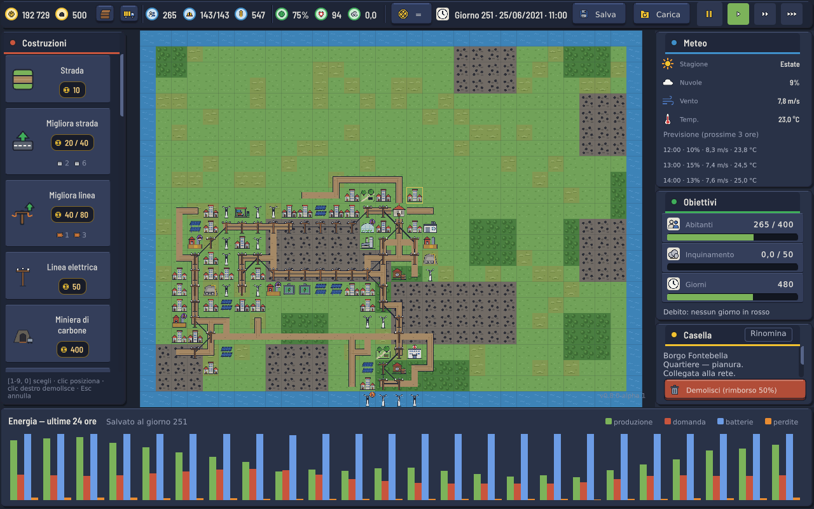
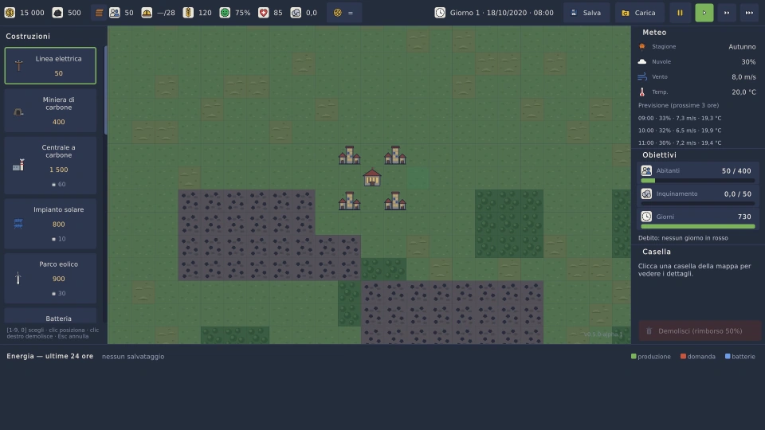

  

🇮🇹 Italiano · 🇬🇧 [English](README.md)

# ⚡ Voltvale: Energy Grid Tycoon

**Sei il gestore elettrico di una cittadina che cresce.** Ogni ora la città chiede energia: poca di notte, tanta
la sera. Costruisci centrali, impianti solari, parchi eolici e batterie, collega tutto con le linee elettriche e
le strade, trova chi ci lavori, dai da mangiare a tutti, porta merci e materiali coi camion senza intasare il
traffico, e fai crescere la città fino a **400 abitanti in due anni di gioco**, senza blackout continui, senza
debiti e senza soffocarla di inquinamento.

Un gioco originale di **Marco Scarlino**. Gratuito.

## Trailer

**[▶ Guarda il trailer (1 minuto)](https://scrnetto.github.io/energy-grid-tycoon-releases/trailer/voltvale-trailer-it.mp4)** ·
[in inglese](https://scrnetto.github.io/energy-grid-tycoon-releases/trailer/voltvale-trailer-en.mp4)

> **Stato: in sviluppo (alpha).** Il gioco si gioca dall'inizio alla fine, ma mancano ancora molte cose e qualcosa
> può non funzionare. Ogni segnalazione aiuta: vedi [Segnalare un problema o un'idea](#segnalare-un-problema-o-unidea).

## Gioca subito nel browser

**[▶ Gioca a Voltvale nel browser](https://scrnetto.github.io/energy-grid-tycoon-releases/)**: niente da
installare. Serve un browser recente (Chrome, Firefox, Edge, Safari) su un computer con mouse e tastiera, oppure su
un tablet: **tocco = clic, tocco lungo = clic destro**. Clicca sul gioco prima di usare la tastiera. I salvataggi
restano nel browser che usi.

**C'è anche su itch.io: [marcoscarlino.itch.io/voltvale](https://marcoscarlino.itch.io/voltvale)**, dove puoi
giocare nel browser, scaricare il gioco per ogni sistema e lasciare un commento. I salvataggi fatti nel browser su
itch.io sono separati da quelli fatti qui.

## Scaricare il gioco

Tutte le versioni sono nella pagina **[Releases](../../releases)**. Scarica il file del tuo sistema dall'ultima
versione:

| Sistema | File | Come avviarlo |
|---|---|---|
| **Windows** 10/11 (64 bit) | `Voltvale-<versione>-windows.zip` | Estrai lo zip e apri `Voltvale.exe` |
| **macOS** 12 o successivo | `Voltvale-<versione>-macos.zip` | Estrai lo zip e apri `Voltvale.app` |
| **Linux** (64 bit) | `Voltvale-<versione>-linux.zip` | Estrai lo zip e avvia `Voltvale` |
| **Android** 8 o successivo (tablet o telefono grande) | `Voltvale-<versione>-android.apk` | Apri il file sul dispositivo e installalo (vedi sotto) |

### Al primo avvio

Il gioco non è firmato con un certificato a pagamento, quindi il sistema può avvisarti che viene da uno
sviluppatore sconosciuto. È normale per i giochi indipendenti.

- **Windows**: se compare «Windows ha protetto il PC», clicca **Ulteriori informazioni**, poi **Esegui comunque**.
- **macOS**: se compare «impossibile aprire perché lo sviluppatore non è verificato», fai **clic destro
  sull'app → Apri**, poi conferma con **Apri**. Basta la prima volta. Se il Mac dice che l'app «è danneggiata»,
  apri il Terminale nella cartella dello zip e scrivi `xattr -cr Voltvale.app`.
- **Linux**: se non parte, rendi il file eseguibile con `chmod +x Voltvale`.
- **Android**: il gioco non è sul Play Store. Scarica l'`.apk` sul dispositivo e aprilo; la prima volta Android
  chiede di permettere le installazioni dal browser o dal gestore dei file («Installa app sconosciute»). Play
  Protect può avvisare che l'app è sconosciuta: scegli di installarla comunque. Per aggiornare, installa il nuovo
  `.apk` sopra il vecchio. Sullo schermo touch: **tocco = clic, tocco lungo = clic destro**, due dita per spostare
  la mappa e per ingrandirla.

**Controllare il download (facoltativo).** Ogni versione ha un file `SHA256SUMS.txt` con l'impronta di ogni zip.
Su Linux si controlla con `sha256sum -c --ignore-missing SHA256SUMS.txt`, su macOS con `shasum -a 256 -c SHA256SUMS.txt`.

### Requisiti

- Uno schermo da almeno 1280×800.
- Mouse e tastiera, oppure un tablet (versione web o Android).
- Circa 200 MB di spazio.
- Una scheda video qualsiasi degli ultimi 10 anni: anche quelle integrate vanno bene.

## Come si gioca

Il gioco si apre con il **menu iniziale**: **Nuova partita**, oppure **Continua** per riprendere l'ultimo
salvataggio. La partita comincia il **18 ottobre 2020** e parte **in pausa**: premi **Spazio** per far scorrere il
tempo. A velocità 1× un'ora di gioco dura un secondo, e puoi accelerare a 2× e 4×. Le stagioni seguono il
calendario: si parte in autunno, e d'inverno le giornate sono più corte e il cielo più coperto.

- **Obiettivo**: arrivare a **400 abitanti** con l'inquinamento **sotto la soglia** entro **2 anni**.
- **Sconfitta**: se resti in rosso con i soldi per **30 giorni di fila**, oppure se finiscono i 2 anni.
- **La rete**: ogni costruzione deve essere collegata al **municipio**. Le **linee elettriche** partono dal
  municipio e lo allungano, anche in diagonale. Una costruzione è collegata se tocca il municipio, una linea
  oppure un'altra costruzione già collegata: un gruppo di costruzioni attaccate è collegato se una di loro tocca
  la rete.
- **Le strade**: oltre alla corrente, ogni costruzione deve toccare con un lato una **strada collegata al
  municipio** (le linee elettriche no). Vedi [Strade e traffico](#strade-e-traffico).
- **Domanda ed energia**: la città consuma poco di notte e molto la sera, verso le 19. Se l'energia non basta
  c'è il **blackout**: gli abitanti si arrabbiano e qualcuno se ne va.
- **Le fonti**:
  - il **sole** produce solo di giorno, poco d'inverno e col cielo coperto;
  - il **vento** cambia di ora in ora;
  - il **carbone** produce sempre, ma inquina e consuma il carbone estratto dalle **miniere**.
- **Batterie**: accumulano l'energia in più e la restituiscono quando serve, per esempio la sera.
- **Il surplus** si vende alla rete esterna, ma più ne offri e meno vale.
- **Inquinamento**: le centrali a carbone inquinano e l'aria si pulisce piano. Una centrale si regge, troppe no.
  Fa ammalare gli abitanti, e sopra la soglia non si vince.
- **Crescita**: la città cresce se gli abitanti sono abbastanza **felici**, c'è posto nei **quartieri** e c'è abbastanza
  **cibo** in magazzino.

### Lavoro e personale

Le costruzioni hanno bisogno di qualcuno che le faccia funzionare.

- Lavora circa il **56 %** degli abitanti. La barra in alto mostra i posti occupati sulla forza lavoro disponibile.
- **Centrali a carbone**, **impianti solari**, **parchi eolici**, **miniere di carbone**, le **industrie** e le
  costruzioni del **cibo** hanno bisogno di personale. Il pannello **Casella** mostra quanto ne hanno, per esempio **Personale: 8/10**.
- Con poco personale una costruzione produce meno; **senza nessuno si ferma** e mostra il segnale **«senza
  personale»**.
- I lavoratori vanno **prima all'energia**, poi **al cibo**, poi **agli ospedali**, poi **alle industrie**, poi **alle miniere**, poi **ai servizi**
  (quartieri e parchi). I quartieri funzionano anche quando ai loro servizi manca personale.
- La **disoccupazione** fa entrare meno tasse e, se è alta, rende gli abitanti meno felici.

### Cibo

Gli abitanti mangiano ogni ora. La scorta di cibo è nella barra in alto, accanto alla spiga, e diventa rossa quando
sta per finire.

- **Fattoria** (pianura): produce secondo la stagione, molto d'estate e **niente d'inverno**.
- **Peschereccio** (costa): pesca tutto l'anno, ma si ferma quando il vento è troppo forte.
- **Serra** (pianura o collina): produce tutto l'anno, però **consuma molta energia**.
- **Magazzino frigorifero** (pianura): fa crescere la scorta che la città può tenere.
- **Il cibo passa dalla rete**: le costruzioni del cibo consumano energia. Durante un **blackout** non producono e
  i frigoriferi perdono una parte del cibo in più.
- **Se la scorta finisce**, il cibo arriva da fuori in automatico, ma costa caro. Con il cibo importato la città
  non muore di fame, però **non cresce**: per crescere serve almeno un giorno di scorta propria.
- **Se finiscono anche i soldi** arriva la fame, e gli abitanti se ne vanno.
- Il pannello **Casella** mostra quanto produce ogni costruzione (per esempio **Cibo: 2,0/h**), quanto spazio
  aggiunge un frigorifero e quanta energia consuma.

### Felicità, salute e tasse

- **Felicità** (lo smile nella barra in alto): si muove piano verso un valore che è la somma di alcuni fattori, cioè
  blackout delle ultime 24 ore, cibo, fame, disoccupazione, inquinamento, salute, parchi e tasse. Passando il
  mouse sul numero vedi verso quale valore sta andando e quanto pesa ogni fattore, per esempio «Blackout −5,0» o
  «Parchi +3,0». Sotto 60 la città non cresce, e sotto 35 la gente comincia ad andarsene.
- **Salute** (il cuore): cala con l'inquinamento e con la fame. I **malati restano a casa**, quindi ci sono meno
  lavoratori, e una città poco sana è anche meno felice.
- **Ospedale** (pianura): cura fino a 250 abitanti, ha bisogno di personale e consuma energia. Durante un
  blackout non cura. Indispensabile se punti sul carbone.
- **Parco** (pianura o collina): rende la gente più felice. Conta di più in una città piccola: ogni parco vale +3
  ogni 100 abitanti, fino a +10.
- **Tasse**: tre livelli, basse, normali e alte, con il pulsante con la moneta nella barra in alto o il tasto
  **T**. Tasse alte portano più soldi ma meno felicità; tasse basse fanno il contrario.

### Materiali e industrie

Quasi tutte le costruzioni costano, oltre ai soldi, dei **materiali**: **legname** e **cemento**. La lista a
sinistra li mostra sotto il prezzo, con piccole icone; passando il mouse sul pulsante si leggono per esteso.

- **Segheria** (solo nel **bosco**, le caselle verde scuro): 2 legname all'ora.
- **Cava** (colline): 2 pietra all'ora.
- **Cementificio** (pianura): trasforma 2 pietra in 2 cemento all'ora e consuma molta corrente. Senza pietra si
  ferma, e smette anche di consumare corrente.
- Le industrie hanno bisogno di **personale** e di **corrente**. I lavoratori ci vanno dopo energia, cibo e
  ospedali, e prima delle miniere di carbone.
- **Se i materiali non bastano** quando costruisci, la parte che manca si compra subito da fuori (legname 10,
  cemento 20 l'unità). Si può giocare anche senza industrie, ma costa di più.
- Si parte con 200 di legname e 200 di cemento.
- Il pulsante **Scorte**, accanto al carbone nella barra in alto, apre un piccolo pannello con carbone, legname,
  pietra, cemento e cibo, e quanto entra ed esce ogni ora. Si chiude con un clic fuori o con **Esc**.
- Il pannello **Casella** mostra quanto produce e consuma un'industria, e «fermo: manca pietra» quando è finita.

### Strade e traffico

- Ogni costruzione, linee escluse, deve toccare con un lato una **strada collegata al municipio**. Senza strada è
  ferma e mostra il segnale «senza strada». Si parte con quattro sterrate attorno al municipio.
- Strumento **Strada** (tasto **R**, o il primo pulsante della lista): clic o trascina per posare le **sterrate**.
  Una strada può passare sotto una linea elettrica, ma non sotto altre costruzioni.
- Strumento **Migliora strada** (tasto **M**): **sterrata → strada asfaltata → viale**. Ogni livello porta più
  traffico ed è più veloce, ma costa cemento. Dopo il miglioramento la casella resta qualche ora in **cantiere**, con
  meno spazio per il traffico.
- **Pendolari**: la mattina i lavoratori vanno dai quartieri al lavoro, il pomeriggio tornano a casa. Se le strade
  sono piene si va piano: chi arriva in ritardo rende meno, e il ritardo del giorno prima toglie **felicità**
  («Traffico dei pendolari» nel riquadro della felicità).
- I **viali** reggono molto traffico ma sono **rumorosi**: tolgono un po' di felicità ai quartieri accanto.
- **Mappa del traffico** (tasto **G**): colora le strade secondo quanto sono cariche.
- Pannello **Trasporti** (tasto **J** o il pulsante con il camion in alto): persone e merci in viaggio, tempo medio,
  camion usati, le **strade più cariche** (un clic le mostra nella Casella) e l'andamento delle ultime 24 ore.
- Per demolire una strada: clic destro, come per le costruzioni (rimborso di metà della spesa).

### Merci e camion

- Chi produce (miniere, segheria, cava, cementificio, fattorie, pescherecci, serre) mette la merce nel suo
  **piazzale**. I **camion** la portano al municipio o al **deposito** più vicino, e da lì ai **silo** di chi la
  consuma: le centrali a carbone e il cementificio. Il magazzino frigorifero fa da deposito per il cibo.
- Il municipio ha **2 camion**; ogni **autoparco** ne aggiunge **3** (servono personale e corrente). Strade migliori
  e meno traffico fanno viaggiare di più gli stessi camion.
- Se i camion non bastano arriva l'avviso «**Camion insufficienti**»: i piazzali si riempiono e chi produce si ferma
  («fermo: piazzale pieno»). Serve un autoparco, o un deposito più vicino.
- Il **cibo si rovina** un po' a ogni viaggio: più la fattoria è lontana, più se ne perde.
- La Casella mostra piazzale, silo e distanza dal deposito; le **Scorte** mostrano quanto aspetta nei piazzali.

### Perdite di linea

- L'energia di una centrale si perde lungo le linee fino al **nodo** più vicino: il **municipio** o un
  **trasformatore** (si costruisce dalla lista). Più la centrale è lontana, più perde; la Casella mostra quanto.
- Strumento **Migliora linea** (tasto **L**): le linee passano dal livello **I** al **II** e al **III** e perdono
  meno, ma costano **rame**, che si compra da fuori.
- Il grafico in basso ha una riga per le perdite.

### Miniere e laghi

- Ogni giacimento ha la sua **riserva** di carbone, diversa da casella a casella: la Casella della miniera mostra
  quanta ne resta e per quanti giorni. Quando sta per finire la miniera rende meno; arrivano gli avvisi «miniera
  quasi esaurita» e «miniera esaurita».
- Tre giorni dopo l'esaurimento la miniera sparisce e al suo posto nasce un **lago**. Il lago:
  - rinfresca le **centrali a carbone** vicine, che producono un po' di più;
  - fa piacere ai **quartieri** accanto, come un parco;
  - ospita i **pescherecci**;
  - permette il **pompaggio**, una batteria grande che si costruisce solo accanto a un lago.

### Nomi

- Vie, quartieri, ospedali e parchi hanno un **nome**, e la Casella lo mostra in cima: per esempio «Via Volta» o
  «Borgo Valfiora». Una via tiene lo stesso nome lungo tutto il suo tratto dritto.
- Il pulsante **Rinomina** nella Casella cambia il nome; lasciandolo vuoto torna quello automatico.

### Comandi

Passa il mouse su qualsiasi icona o pulsante: un riquadro spiega che cos'è. Fermandolo su una costruzione della
mappa vedi il suo stato e quanta energia produce o consuma.

| Comando | Cosa fa |
|---|---|
| Tasti **1–9** e **0** | Scegli cosa costruire: linea elettrica, miniera di carbone, centrale a carbone, impianto solare, parco eolico, batteria, quartiere, fattoria, peschereccio, serra. Le altre costruzioni (magazzino frigorifero, parco, ospedale, industrie, depositi, trasformatore, pompaggio) si scelgono dalla lista a sinistra |
| **Clic sinistro** | Posa la costruzione scelta. Senza nessuna scelta seleziona una casella e ne mostra i dettagli |
| **Clic destro** (sul tablet: tocco lungo) | Con una costruzione scelta, annulla la scelta. Senza scelta, chiede conferma per demolire (rimborso di metà del costo) |
| **Esc** | Annulla la scelta; se non c'è niente da annullare apre il **menu di pausa** (Riprendi, Salva come…, Salvataggio rapido, Carica partita, Salva ed esci al menu, Nuova partita, Lingua) |
| **F11** | Schermo intero / finestra |
| **Spazio** o pulsante ▶/❚❚ | Pausa / riprendi |
| **F** o pulsanti delle frecce | Velocità 1×, 2×, 4× |
| **V** | Avanza di un'ora sola |
| **T** o pulsante con la moneta | Tasse basse, normali, alte |
| **WASD** o **frecce**, tasto centrale del mouse | Sposta la vista |
| **Rotella** | Zoom |
| Pulsante **Scorte** (in alto) | Mostra le scorte di carbone, legname, pietra, cemento e cibo |
| **Salva** / **Carica** (in alto) | **Salva** crea un nuovo salvataggio col nome «Giorno N»; **Carica** riprende il salvataggio più recente. Il gioco salva anche da solo ogni giorno |
| **F5** / **F9** | Salvataggio rapido / carica il salvataggio rapido |
| **R** | Strumento **Strada**: clic o trascina per posare le sterrate |
| **M** | Strumento **Migliora strada**: sterrata → strada asfaltata → viale |
| **L** | Strumento **Migliora linea**: linee di livello I → II → III |
| **G** | Mappa del traffico |
| **J** o pulsante **Trasporti** (in alto) | Pannello dei trasporti: persone, merci, strade più cariche |
| Pulsante **Rinomina** (nella Casella) | Cambia il nome di una via, di un quartiere, di un ospedale o di un parco |

### Lingue

Il gioco è in **italiano, inglese, tedesco, francese e spagnolo**. Dal menu iniziale o da quello di pausa la voce
**Lingua** la cambia al volo, senza riavviare la partita, e la scelta resta salvata. Al primo avvio il gioco usa la
lingua del sistema se è una di queste cinque, altrimenti l'inglese. Nella versione web si può aprire direttamente
una lingua aggiungendo `?lingua=it` (oppure `en`, `de`, `fr`, `es`) all'indirizzo.

### Segnali sulle costruzioni

- **Spina staccata** (cerchio bianco e rosso): la costruzione non è collegata alla rete.
- **Fulmine barrato** (cerchio giallo): è collegata ma non riceve corrente (blackout), oppure una centrale a carbone
  è ferma perché il carbone è finito. Una serra o un frigorifero senza corrente non funzionano.
- **Casco barrato** (cerchio azzurro): **senza personale**, la costruzione è ferma. Costruisci altri quartieri o
  libera lavoratori.
- **Strada interrotta** (cerchio arancione): **senza strada**, nessuna strada collegata al municipio la raggiunge.
- **Pila di casse** (cerchio viola): **piazzale pieno**, i camion non fanno in tempo a portare via la merce.
- **Miniera chiusa con le assi**: la miniera è **esaurita** e fra qualche giorno diventerà un lago.
- **Luci di notte**: col buio quartieri e municipio accendono le luci. Una costruzione senza corrente resta al
  buio: un quartiere spento di notte è un campanello d'allarme.

### Consigli per la prima partita

1. Metti in pausa e guarda la mappa: le **colline** sono buone per l'eolico, i **giacimenti** scuri servono alle
   miniere.
2. Fai partire una **linea** dal municipio verso dove vuoi costruire, e una **strada** (tasto **R**) accanto: ogni
   costruzione deve toccarne una.
3. Comincia con un po' di **solare e di eolico** e una **batteria** per la sera.
4. Non costruire troppe centrali tutte insieme: ognuna ha bisogno di **personale**, e la città è ancora piccola.
5. Costruisci **quartieri** man mano che la produzione regge la domanda.
6. Metti presto una **fattoria** e pensa all'inverno: d'inverno le fattorie si fermano, e servono una scorta,
   un peschereccio o una serra.
7. Nel primo mese metti una **segheria** nel bosco e una **cava** su una collina; aggiungi un **cementificio**
   quando hai un po' di soldi da parte. Comprare i materiali da fuori ogni volta costa.
8. Un **parco** presto alza la felicità quando la città è piccola. Se costruisci centrali a carbone, pensa a un
   **ospedale**.
9. Tieni d'occhio il **grafico in basso**: se la linea rossa (domanda) supera la verde (produzione), sta per
   arrivare un blackout.
10. Quando arriva «Camion insufficienti», costruisci un **autoparco**. Quando la città cresce, guarda la **mappa del
    traffico** (G) e migliora le strade più cariche (M); non mettere i viali proprio accanto ai quartieri.
11. Tieni le centrali vicine al municipio o a un **trasformatore**: lontano perdono energia.

## Salvataggi

- **Salva come…** (menu di pausa): scegli il nome del salvataggio, oppure sovrascrivi uno di quelli che hai già
  fatto. Fino a 50 salvataggi con nome per ogni partita.
- **Salvataggio rapido**: **F5** salva, **F9** riprende da lì. Ce n'è uno per partita e si sovrascrive ogni volta.
  Sul tablet è nel menu di pausa.
- **Salvataggi automatici**: uno all'inizio di ogni giorno di gioco; restano gli ultimi tre.
- **Carica partita** (menu iniziale e menu di pausa): tutti i salvataggi, raggruppati per partita, con giorno,
  denaro, abitanti e data. Da qui puoi **caricare**, **rinominare** un salvataggio con nome o **eliminarne** uno.
- **Continua** (menu iniziale) riprende il salvataggio più recente, di qualunque tipo.

## Dove finiscono i salvataggi

I salvataggi restano sul tuo computer, o nel tuo browser per la versione web, e il gioco non manda niente su
internet.

- **Windows**: `%USERPROFILE%\AppData\LocalLow\Marco Scarlino\Voltvale\salvataggi`
- **macOS**: `~/Library/Application Support/Marco Scarlino/Voltvale/salvataggi`
- **Linux**: `~/.config/unity3d/Marco Scarlino/Voltvale/salvataggi`
- **Android**: dentro l'app; si cancellano se la disinstalli.

**Arrivi da una versione precedente?** Al primo avvio della 0.3.0 il gioco **copia** i salvataggi dalla vecchia
cartella «Energy Grid Tycoon» (stesso percorso, con «Energy Grid Tycoon» al posto di «Voltvale»). La cartella
vecchia resta dov'è. La **lingua** va scelta di nuovo, una volta sola.

**Dalla 0.4.0** i salvataggi hanno un formato nuovo. Quelli delle versioni precedenti si caricano lo stesso: la
città riparte con la scorta di cibo iniziale. Un salvataggio della 0.4.0 non si apre con le versioni precedenti.

**Dalla 0.5.0** il formato cambia di nuovo: tasse e salute. I salvataggi delle versioni precedenti si caricano con
tasse normali e salute iniziale. Un salvataggio della 0.5.0 non si apre con le versioni precedenti.

**Dalla 0.6.0** il formato cambia ancora: i materiali. I salvataggi delle versioni precedenti si caricano con il
legname e il cemento iniziali, e sulla mappa compaiono i boschi; le costruzioni finite in un bosco restano al loro
posto. Un salvataggio della 0.6.0 non si apre con le versioni precedenti.

**Dalla 0.7.0** i salvataggi sono in una cartella per ogni partita. Al primo avvio il gioco trasforma i salvataggi
della versione precedente (il salvataggio e quello automatico) in una partita, che trovi in **Carica partita** e con
**Continua**; i file originali restano nella sottocartella `vecchi`. Le versioni precedenti non vedono i salvataggi
della 0.7.0.

**Dalla 0.8.0** il formato cambia di nuovo: strade, merci, traffico, linee, miniere e nomi. I salvataggi delle
versioni precedenti si caricano: il gioco traccia da solo le sterrate attorno al municipio e una sterrata verso ogni
costruzione; le centrali a carbone ripartono col silo pieno, le miniere con la riserva piena, e vie, quartieri,
ospedali e parchi ricevono un nome. Un salvataggio della 0.8.0 non si apre nelle versioni precedenti.

I salvataggi di una versione alpha potrebbero non funzionare con la versione successiva: lo scrive il
[changelog](CHANGELOG.md) quando succede.

## Prossimamente

Cosa è già previsto, più o meno in quest'ordine. I piani possono cambiare.

- **Orari e turni**: turni giorno e notte per le centrali e gli ospedali, orario d'ufficio per industrie e campi,
  fine settimana più tranquilli; il traffico segue gli orari.
- **Stipendi e conti di casa**: stipendi, bollette, cibo e affitti; gli abitanti felici sono anche quelli che
  arrivano a fine mese.
- **Petrolio, gas e calore**: fonti nuove, e il riscaldamento d'inverno.
- **Acqua e rifiuti**: acquedotti, depuratori e discariche per una città più grande.
- **Istruzione e ricerca**: scuole, e tecnologie da scoprire che sbloccano costruzioni nuove.
- **Mappe nuove**: una mappa diversa a ogni partita, mappe più grandi, una minimappa.
- **Più avanti**: vista isometrica, e più città collegate fra loro.

## Problemi noti

- Le versioni per **Windows** e **macOS** non sono ancora state provate su computer veri: se qualcosa non va,
  [segnalalo](#segnalare-un-problema-o-unidea).
- La versione **Android** si installa a mano, fuori dal Play Store.
- Nella versione **web** i salvataggi stanno nel browser: se cancelli i dati del sito, li perdi.
- È una **alpha**: l'equilibrio del gioco (costi, produzione, crescita, traffico) cambia ancora da una versione
  all'altra.

## Versioni

Le versioni seguono il [versionamento semantico](https://semver.org/lang/it/) con tre fasi:

| Fase | Esempio | Che cosa significa |
|---|---|---|
| **Alpha** | `0.3.0-alpha.1` | Il gioco cambia molto da una versione all'altra; mancano parti; possono esserci errori e salvataggi non compatibili |
| **Beta** | `0.9.0-beta.1` | Tutte le parti principali ci sono; si sistemano errori ed equilibrio del gioco |
| **Stabile** | `1.0.0` | La prima versione completa. Poi `1.0.1` per le correzioni e `1.1.0` per le novità |

Le versioni alpha e beta sono segnate su GitHub come **pre-release**. Cosa cambia in ogni versione è nel
**[CHANGELOG](CHANGELOG.md)** e nella pagina di ogni release.

## Segnalare un problema o un'idea

Apri una segnalazione nella pagina **[Issues](../../issues/new/choose)** e scegli:
- **Problema**: qualcosa non funziona. Scrivi cosa stavi facendo, cosa ti aspettavi e la versione del gioco.
- **Idea**: una proposta per migliorare il gioco.

Serve un account GitHub, che è gratuito. Se non ce l'hai, scrivi pure a Marco direttamente.

## Licenza

Voltvale è **gratuito**: puoi scaricarlo e giocarci quanto vuoi. **Non** puoi ridistribuirlo, venderlo o
modificarlo: per farlo giocare a qualcuno, mandagli il link di questa pagina. I dettagli sono in
[LICENSE.md](LICENSE.md).

## Crediti

Ideazione e realizzazione di **Marco Scarlino**, con Unity e con l'aiuto di strumenti di intelligenza artificiale
per il codice, la grafica e le traduzioni.

Caratteri: Barlow Semi Condensed (SIL Open Font License 1.1), DejaVu Sans (licenza Bitstream Vera).
