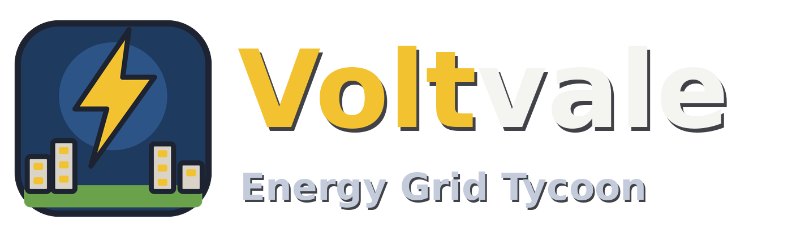

  

🇮🇹 Italiano · 🇬🇧 [English](README.md)

# ⚡ Voltvale: Energy Grid Tycoon

**Sei il gestore elettrico di una cittadina che cresce.** Ogni ora la città chiede energia: poca di notte, tanta
la sera. Costruisci centrali, impianti solari, parchi eolici e batterie, collega tutto con le linee elettriche,
trova chi ci lavori e fai crescere la città fino a **400 abitanti in due anni di gioco**, senza blackout continui,
senza debiti e senza soffocarla di inquinamento.

Un gioco originale di **Marco Scarlino**. Gratuito.

> **Stato: in sviluppo (alpha).** Il gioco si gioca dall'inizio alla fine, ma mancano ancora molte cose e qualcosa
> può non funzionare. Ogni segnalazione aiuta: vedi [Segnalare un problema o un'idea](#segnalare-un-problema-o-unidea).

## Gioca subito nel browser

**[▶ Gioca a Voltvale nel browser](https://scrnetto.github.io/energy-grid-tycoon-releases/)**: niente da
installare. Serve un browser recente (Chrome, Firefox, Edge, Safari) su un computer con mouse e tastiera, oppure su
un tablet: **tocco = clic, tocco lungo = clic destro**. Clicca sul gioco prima di usare la tastiera. I salvataggi
restano nel browser che usi.

## Scaricare il gioco

Tutte le versioni sono nella pagina **[Releases](../../releases)**. Scarica il file del tuo sistema dall'ultima
versione:

| Sistema | File | Come avviarlo |
|---|---|---|
| **Windows** 10/11 (64 bit) | `Voltvale-<versione>-windows.zip` | Estrai lo zip e apri `Voltvale.exe` |
| **macOS** 12 o successivo | `Voltvale-<versione>-macos.zip` | Estrai lo zip e apri `Voltvale.app` |
| **Linux** (64 bit) | `Voltvale-<versione>-linux.zip` | Estrai lo zip e avvia `Voltvale` |

### Al primo avvio

Il gioco non è firmato con un certificato a pagamento, quindi il sistema può avvisarti che viene da uno
sviluppatore sconosciuto. È normale per i giochi indipendenti.

- **Windows**: se compare «Windows ha protetto il PC», clicca **Ulteriori informazioni**, poi **Esegui comunque**.
- **macOS**: se compare «impossibile aprire perché lo sviluppatore non è verificato», fai **clic destro
  sull'app → Apri**, poi conferma con **Apri**. Basta la prima volta. Se il Mac dice che l'app «è danneggiata»,
  apri il Terminale nella cartella dello zip e scrivi `xattr -cr Voltvale.app`.
- **Linux**: se non parte, rendi il file eseguibile con `chmod +x Voltvale`.

**Controllare il download (facoltativo).** Ogni versione ha un file `SHA256SUMS.txt` con l'impronta di ogni zip.
Su Linux si controlla con `sha256sum -c SHA256SUMS.txt`, su macOS con `shasum -a 256 -c SHA256SUMS.txt`.

### Requisiti

- Uno schermo da almeno 1280×800.
- Mouse e tastiera (nella versione web va bene anche un tablet).
- Circa 200 MB di spazio.
- Una scheda video qualsiasi degli ultimi 10 anni: anche quelle integrate vanno bene.

## Come si gioca

Il gioco si apre con il **menu iniziale**: **Nuova partita**, oppure **Continua** per riprendere l'ultimo
salvataggio. La partita comincia il **18 ottobre 2020** e parte **in pausa**: premi **Spazio** per far scorrere il
tempo. A velocità 1× un'ora di gioco dura un secondo, e puoi accelerare a 2× e 4×. Le stagioni seguono il
calendario: si parte in autunno, e d'inverno le giornate sono più corte e il cielo più coperto.

- **Obiettivo**: arrivare a **400 abitanti** con l'inquinamento **sotto la soglia** entro **2 anni**.
- **Sconfitta**: se resti in rosso con i soldi per **30 giorni di fila**, oppure se finiscono i 2 anni.
- **La rete**: ogni costruzione deve essere collegata al **municipio**. Le **linee elettriche** partono dal
  municipio e lo allungano, anche in diagonale. Una costruzione è collegata se tocca il municipio, una linea
  oppure un'altra costruzione già collegata: un gruppo di costruzioni attaccate è collegato se una di loro tocca
  la rete.
- **Domanda ed energia**: la città consuma poco di notte e molto la sera, verso le 19. Se l'energia non basta
  c'è il **blackout**: gli abitanti si arrabbiano e qualcuno se ne va.
- **Le fonti**:
  - il **sole** produce solo di giorno, poco d'inverno e col cielo coperto;
  - il **vento** cambia di ora in ora;
  - il **carbone** produce sempre, ma inquina e consuma il carbone estratto dalle **miniere**.
- **Batterie**: accumulano l'energia in più e la restituiscono quando serve, per esempio la sera.
- **Il surplus** si vende alla rete esterna, ma più ne offri e meno vale.
- **Inquinamento**: le centrali a carbone inquinano e l'aria si pulisce piano. Una centrale si regge, troppe no.
  Sopra la soglia la gente è scontenta e la città smette di crescere.
- **Crescita**: la città cresce se gli abitanti sono contenti e c'è posto nei **quartieri**.

### Lavoro e personale

Le costruzioni hanno bisogno di qualcuno che le faccia funzionare.

- Lavora circa il **56 %** degli abitanti. La barra in alto mostra i posti occupati sulla forza lavoro disponibile.
- **Centrali a carbone**, **impianti solari**, **parchi eolici** e **miniere di carbone** hanno bisogno di
  personale. Il pannello **Casella** mostra quanto ne hanno, per esempio **Personale: 8/10**.
- Con poco personale una costruzione produce meno; **senza nessuno si ferma** e mostra il segnale **«senza
  personale»**.
- I lavoratori vanno **prima all'energia**, poi **alle miniere**, poi **ai servizi dei quartieri** (negozi, scuole
  di quartiere). I quartieri funzionano anche quando ai loro servizi manca personale.
- La **disoccupazione** fa entrare meno tasse e, se è alta, rende gli abitanti un po' meno contenti.

### Comandi

Passa il mouse su qualsiasi icona o pulsante: un riquadro spiega che cos'è. Fermandolo su una costruzione della
mappa vedi il suo stato e quanta energia produce o consuma.

| Comando | Cosa fa |
|---|---|
| Tasti **1–7** | Scegli cosa costruire: linea elettrica, miniera di carbone, centrale a carbone, impianto solare, parco eolico, batteria, quartiere |
| **Clic sinistro** | Posa la costruzione scelta. Senza nessuna scelta seleziona una casella e ne mostra i dettagli |
| **Clic destro** (sul tablet: tocco lungo) | Con una costruzione scelta, annulla la scelta. Senza scelta, chiede conferma per demolire (rimborso di metà del costo) |
| **Esc** | Annulla la scelta; se non c'è niente da annullare apre il **menu di pausa** (Riprendi, Salva ed esci al menu, Nuova partita, Lingua) |
| **F11** | Schermo intero / finestra |
| **Spazio** o pulsante ▶/❚❚ | Pausa / riprendi |
| **F** o pulsanti delle frecce | Velocità 1×, 2×, 4× |
| **V** | Avanza di un'ora sola |
| **WASD** o **frecce**, tasto centrale del mouse | Sposta la vista |
| **Rotella** | Zoom |
| **Salva** / **Carica** (in alto) | Salva o riprende la partita. Il gioco salva anche da solo ogni giorno |

### Lingue

Il gioco è in **italiano, inglese, tedesco, francese e spagnolo**. Dal menu iniziale o da quello di pausa la voce
**Lingua** la cambia al volo, senza riavviare la partita, e la scelta resta salvata. Al primo avvio il gioco usa la
lingua del sistema se è una di queste cinque, altrimenti l'inglese. Nella versione web si può aprire direttamente
una lingua aggiungendo `?lingua=it` (oppure `en`, `de`, `fr`, `es`) all'indirizzo.

### Segnali sulle costruzioni

- **Spina staccata** (cerchio bianco e rosso): la costruzione non è collegata alla rete.
- **Fulmine barrato** (cerchio giallo): è collegata ma non riceve corrente (blackout), oppure una centrale a carbone
  è ferma perché il carbone è finito.
- **Casco barrato** (cerchio azzurro): **senza personale**, la costruzione è ferma. Costruisci altri quartieri o
  libera lavoratori.
- **Luci di notte**: col buio quartieri e municipio accendono le luci. Una costruzione senza corrente resta al
  buio: un quartiere spento di notte è un campanello d'allarme.

### Consigli per la prima partita

1. Metti in pausa e guarda la mappa: le **colline** sono buone per l'eolico, i **giacimenti** scuri servono alle
   miniere.
2. Fai partire una **linea** dal municipio verso dove vuoi costruire.
3. Comincia con un po' di **solare e di eolico** e una **batteria** per la sera.
4. Non costruire troppe centrali tutte insieme: ognuna ha bisogno di **personale**, e la città è ancora piccola.
5. Costruisci **quartieri** man mano che la produzione regge la domanda.
6. Tieni d'occhio il **grafico in basso**: se la linea rossa (domanda) supera la verde (produzione), sta per
   arrivare un blackout.

## Dove finiscono i salvataggi

I salvataggi restano sul tuo computer, o nel tuo browser per la versione web, e il gioco non manda niente su
internet.

- **Windows**: `%USERPROFILE%\AppData\LocalLow\Marco Scarlino\Voltvale\salvataggi`
- **macOS**: `~/Library/Application Support/Marco Scarlino/Voltvale/salvataggi`
- **Linux**: `~/.config/unity3d/Marco Scarlino/Voltvale/salvataggi`

**Arrivi da una versione precedente?** Al primo avvio della 0.3.0 il gioco **copia** i salvataggi dalla vecchia
cartella «Energy Grid Tycoon» (stesso percorso, con «Energy Grid Tycoon» al posto di «Voltvale»). La cartella
vecchia resta dov'è. La **lingua** va scelta di nuovo, una volta sola.

I salvataggi di una versione alpha potrebbero non funzionare con la versione successiva: lo scrive il
[changelog](CHANGELOG.md) quando succede.

## Versioni

Le versioni seguono il [versionamento semantico](https://semver.org/lang/it/) con tre fasi:

| Fase | Esempio | Che cosa significa |
|---|---|---|
| **Alpha** | `0.3.0-alpha.1` | Il gioco cambia molto da una versione all'altra; mancano parti; possono esserci errori e salvataggi non compatibili |
| **Beta** | `0.9.0-beta.1` | Tutte le parti principali ci sono; si sistemano errori ed equilibrio del gioco |
| **Stabile** | `1.0.0` | La prima versione completa. Poi `1.0.1` per le correzioni e `1.1.0` per le novità |

Le versioni alpha e beta sono segnate su GitHub come **pre-release**. Cosa cambia in ogni versione è nel
**[CHANGELOG](CHANGELOG.md)** e nella pagina di ogni release.

## Segnalare un problema o un'idea

Apri una segnalazione nella pagina **[Issues](../../issues/new/choose)** e scegli:
- **Problema**: qualcosa non funziona. Scrivi cosa stavi facendo, cosa ti aspettavi e la versione del gioco.
- **Idea**: una proposta per migliorare il gioco.

Serve un account GitHub, che è gratuito. Se non ce l'hai, scrivi pure a Marco direttamente.

## Licenza

Voltvale è **gratuito**: puoi scaricarlo e giocarci quanto vuoi. **Non** puoi ridistribuirlo, venderlo o
modificarlo: per farlo giocare a qualcuno, mandagli il link di questa pagina. I dettagli sono in
[LICENSE.md](LICENSE.md).

## Crediti

Ideazione e realizzazione di **Marco Scarlino**, con Unity e con l'aiuto di strumenti di intelligenza artificiale
per il codice, la grafica e le traduzioni.
