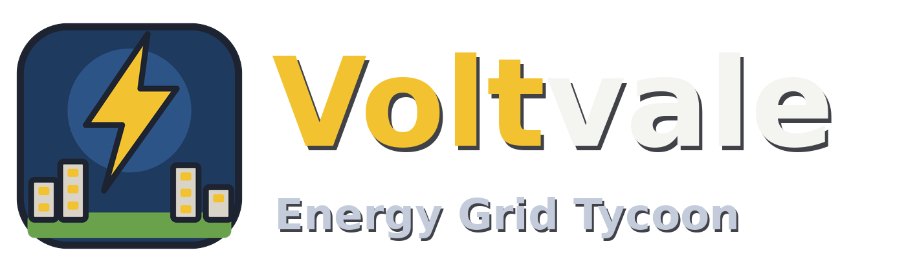
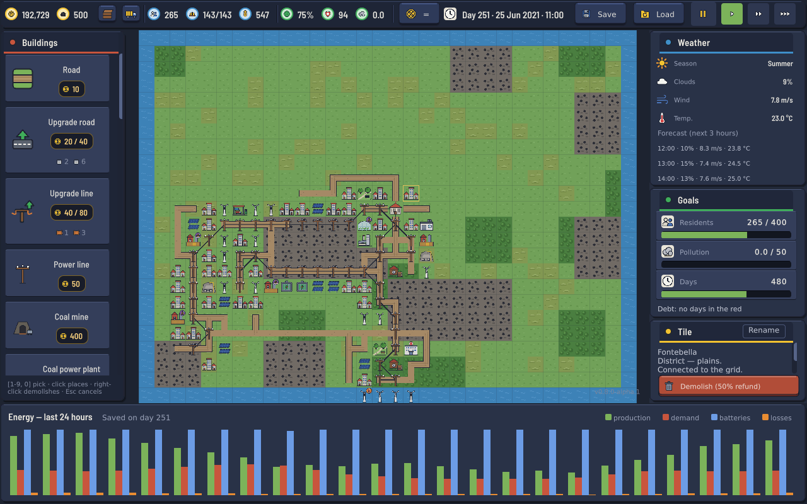
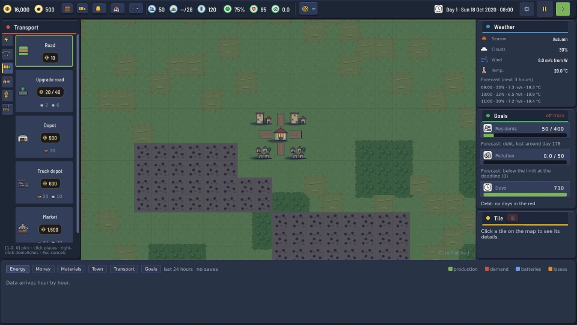

  

🇬🇧 English · 🇮🇹 [Italiano](README.it.md)

# ⚡ Voltvale: Energy Grid Tycoon

**You run the power grid of a growing town.** Every hour the town needs energy: a little at night, a lot in the
evening. Build power plants, solar farms, wind farms and batteries, connect everything with power lines and
roads, find people to work in them, feed everyone, move freight and materials by truck without jamming the
traffic, and grow the town to **400 residents within two game years**, without constant blackouts, without debt
and without choking it with pollution.

An original game by **Marco Scarlino**. Free to play.

## Trailer

**[▶ Watch the trailer (1 minute)](https://scrnetto.github.io/energy-grid-tycoon-releases/trailer/voltvale-trailer-en.mp4)** ·
[in Italian](https://scrnetto.github.io/energy-grid-tycoon-releases/trailer/voltvale-trailer-it.mp4)

> **Status: in development (alpha).** You can play from start to finish, but a lot is still missing and some
> things may not work. Every report helps: see [Reporting a problem or an idea](#reporting-a-problem-or-an-idea).

## Play now in your browser

**[▶ Play Voltvale in your browser](https://scrnetto.github.io/energy-grid-tycoon-releases/)**: nothing to
install. You need a recent browser (Chrome, Firefox, Edge, Safari) on a computer with a mouse and keyboard, or a
tablet: **tap = click, long press = right-click**. Click on the game before using the keyboard. Your saves stay in
the browser you use.

**Also on itch.io: [marcoscarlino.itch.io/voltvale](https://marcoscarlino.itch.io/voltvale)**, where you can play
in the browser, download the game for every system and leave a comment. Saves made in the browser on itch.io are
separate from those made here.

## Download the game

Every version is on the **[Releases](../../releases)** page and on
**[itch.io](https://marcoscarlino.itch.io/voltvale)**. Download the file for your system from the latest
version:

| System | File | How to start it |
|---|---|---|
| **Windows** 10/11 (64-bit) | `Voltvale-<version>-windows.zip` | Extract the zip and open `Voltvale.exe` |
| **macOS** 12 or later | `Voltvale-<version>-macos.zip` | Extract the zip and open `Voltvale.app` |
| **Linux** (64-bit) | `Voltvale-<version>-linux.zip` | Extract the zip and run `Voltvale` |
| **Android** 8 or later (tablet or large phone) | `Voltvale-<version>-android.apk` | Open the file on the device and install it (see below) |

### First launch

The game isn't signed with a paid certificate, so your system may warn you that it comes from an unknown
developer. This is normal for independent games.

- **Windows**: if you see «Windows protected your PC», click **More info**, then **Run anyway**.
- **macOS**: if you see «cannot be opened because the developer cannot be verified», **right-click the app →
  Open**, then confirm with **Open**. You only need to do this once. If your Mac says the app «is damaged», open
  Terminal in the folder of the zip and type `xattr -cr Voltvale.app`.
- **Linux**: if it doesn't start, make the file executable with `chmod +x Voltvale`.
- **Android**: the game isn't on the Play Store. Download the `.apk` on the device and open it; Android asks you to
  allow installs from your browser or file manager the first time («Install unknown apps»). Play Protect may
  warn you about an unknown app: choose to install anyway. To update, install the new `.apk` over the old one.
  On a touch screen: **tap = click, long press = right-click**, two fingers to pan and pinch to zoom.

**Checking the download (optional).** Each version has a `SHA256SUMS.txt` file with the fingerprint of every zip.
On Linux run `sha256sum -c --ignore-missing SHA256SUMS.txt`, on macOS `shasum -a 256 -c SHA256SUMS.txt`.

### Requirements

- A screen of at least 1280×800.
- Mouse and keyboard, or a tablet (web or Android version).
- About 200 MB of free space.
- Any graphics card from the last 10 years: built-in ones are fine too.

## How to play

The game opens with the **start menu**: **New game**, or **Continue** to pick up your last save. The game starts on
**18 October 2020** and begins **paused**: press **Space** to start the clock. At 1× speed one game hour lasts one
second, and you can speed up to 2× and 4×. The seasons follow the calendar: you start in autumn, and in winter the
days are shorter and the sky is cloudier.

- **Goal**: reach **400 residents** with pollution **below the limit** within **2 years**.
- **Defeat**: if your money stays in the red for **30 days in a row**, or if the 2 years run out.
- **The grid**: every building must be connected to the **town hall**. **Power lines** start from the town hall
  and extend it, diagonals included. A building is connected if it touches the town hall, a line or another
  connected building: a group of buildings side by side is connected if one of them touches the grid.
- **Roads**: besides power, every building must touch, with one side, a **road connected to the town hall** (power
  lines don't need one). See [Roads and traffic](#roads-and-traffic).
- **Demand and energy**: the town uses little energy at night and a lot in the evening, around 7 pm. If there
  isn't enough, there's a **blackout**: residents get angry and some leave.
- **Energy sources**:
  - the **sun** only produces by day, and little in winter or under clouds;
  - the **wind** changes from hour to hour;
  - **coal** always produces, but it pollutes and burns the coal dug up by the **mines**.
- **Batteries** store the extra energy and give it back when needed, for example in the evening.
- **Surplus energy** is sold to the outside grid, but the more you offer, the less it's worth.
- **Pollution**: coal power plants pollute and the air clears slowly. One power plant is fine, too many are not.
  It makes residents sick, and above the limit you can't win.
- **Growth**: the town grows if residents are **happy** enough, there's room in the **districts** and there's enough
  **food** in store.

### Work and staff

Buildings need people to run them.

- About **56 %** of the residents work. The bar at the top shows filled jobs out of the available workforce.
- **Coal power plants**, **solar farms**, **wind farms**, **coal mines**, **industries** and the **food** buildings need staff. The **Tile** panel shows
  how many they have, for example **Staff: 8/10**.
- With too few staff a building produces less; **with no staff at all it stops** and shows the **«no staff»**
  signal.
- Workers go **to energy first**, then **to food**, then **to hospitals**, then **to industries**, then **to the mines**, then **to services** (districts and parks).
  Districts keep working even when their services are short of staff.
- **Unemployment** means less tax income, and if it's high, less happy residents.

### Food

Residents eat every hour. The food stock is in the top bar, next to the ear of wheat, and turns red when it's
running low.

- **Farm** (plains): produces with the seasons, a lot in summer and **nothing in winter**.
- **Fishing boat** (coast): fishes all year round, but stops when the wind is too strong.
- **Greenhouse** (plains or hills): produces all year round, but **uses a lot of power**.
- **Cold store** (plains): raises how much food the town can keep.
- **Food runs on the grid**: food buildings use power. During a **blackout** they don't produce, and cold stores
  lose part of the extra food.
- **If the stock runs out**, food is imported automatically, but it's expensive. Imported food keeps the town from
  starving, but it **doesn't grow**: growth needs at least one day of its own stock.
- **If the money runs out too**, famine hits and residents leave.
- The **Tile** panel shows how much each building produces (for example **Food: 2.0/h**), how much room a cold
  store adds, and how much power it uses.

### Happiness, health and taxes

- **Happiness** (the smiley in the top bar): it moves slowly towards a value that is the sum of a few factors,
  namely blackouts in the last 24 hours, food, hunger, unemployment, pollution, health, parks and taxes. Hover
  over the number to see where it's heading and how much each factor weighs, for example «Blackouts −5.0» or
  «Parks +3.0». Below 60 the town doesn't grow, and below 35 people start to leave.
- **Health** (the heart): drops with pollution and hunger. **Sick people stay home**, so there are fewer workers,
  and an unhealthy town is also a less happy one.
- **Hospital** (plains): treats up to 250 residents, needs staff and uses power. It can't treat anyone during a
  blackout. A must if you go for coal.
- **Park** (plains or hills): makes people happier. It counts for more in a small town: each park is worth +3 per
  100 residents, up to +10.
- **Taxes**: three levels, low, normal and high, with the coin button in the top bar or the **T** key. High taxes
  bring in more money but less happiness; low taxes do the opposite.

### Materials and industries

Most buildings cost **materials** as well as money: **timber** and **cement**. The list on the left shows them
under the price, with small icons; hover over the button to read them in full.

- **Sawmill** (only in the **woods**, the dark green tiles): 2 timber per hour.
- **Quarry** (hills): 2 stone per hour.
- **Cement works** (plains): turns 2 stone into 2 cement per hour, and uses a lot of power. Without stone it
  stops, and stops using power too.
- Industries need **staff** and **power**. Workers go to them after energy, food and hospitals, and before the
  coal mines.
- **If you don't have enough materials** when you build, the missing part is bought from outside straight away
  (timber 10, cement 20 each). You can play without industries, but it costs more.
- You start with 200 timber and 200 cement.
- The **Stocks** button, next to coal in the top bar, opens a small panel with coal, timber, stone, cement and
  food, and how much comes in and goes out each hour. Click outside it or press **Esc** to close it.
- The **Tile** panel shows what an industry produces and uses, and «stopped: no stone» when it has run out.

### Roads and traffic

- Every building except power lines must touch, with one side, a **road connected to the town hall**. Without one
  it stops and shows the «no road» signal. You start with four dirt roads around the town hall.
- **Road** tool (**R** key, or the first button of the list): click or drag to lay **dirt roads**. A road can run
  under a power line, but not under other buildings.
- **Upgrade road** tool (**M** key): **dirt road → paved road → avenue**. Each level carries more traffic and is
  faster, but costs cement. After an upgrade the tile stays **under construction** for a few hours, with less room
  for traffic.
- **Commuters**: in the morning workers go from the districts to work, in the afternoon they go home. If the roads
  are full, everyone slows down: late workers produce less, and the previous day's delays cost **happiness**
  («Commuter traffic» in the happiness tooltip).
- **Avenues** carry a lot of traffic but are **noisy**: they take a little happiness from the districts next to them.
- **Traffic map** (**G** key): colours the roads by how busy they are.
- **Transport** panel (**J** key or the truck button at the top): people and freight on the move, average travel
  time, trucks in use, the **busiest roads** (click one to see it in the Tile panel) and the last 24 hours.
- To demolish a road: right-click, as for buildings (half the cost refunded).

### Freight and trucks

- Producers (mines, sawmills, quarries, cement works, farms, fishing boats, greenhouses) put their goods in their
  **yard**. **Trucks** take them to the town hall or the nearest **depot**, and from there to the **silos** of
  whoever uses them: coal power plants and the cement works. The cold store works as the depot for food.
- The town hall has **2 trucks**; each **truck depot** adds **3** (it needs staff and power). Better roads and less
  traffic let the same trucks carry more.
- If there aren't enough trucks you get the «**Not enough trucks**» warning: yards fill up and producers stop
  («stopped: yard full»). Build a truck depot, or a depot closer by.
- **Food spoils** a little on every trip: the farther the farm, the more you lose.
- The **Tile** panel shows yard, silo and distance from the depot; **Stocks** shows what is waiting in the yards.

### Line losses

- A power plant's energy is partly lost along the lines on the way to the nearest **node**: the **town hall** or a
  **transformer** (built from the list). The farther the plant, the more it loses; the Tile panel shows how much.
- **Upgrade line** tool (**L** key): lines go from level **I** to **II** and **III** and lose less, but cost
  **copper**, which is bought from outside.
- The chart at the bottom has a line for losses.

### Mines and lakes

- Every coal deposit has its own **reserve**, different from tile to tile: a mine's Tile panel shows how much is
  left and for how many days. When it's nearly empty the mine produces less; you get the «mine nearly exhausted»
  and «mine exhausted» warnings.
- Three days after it runs out, the mine disappears and a **lake** takes its place. A lake:
  - cools nearby **coal power plants**, which produce a little more;
  - pleases the **districts** next to it, like a park;
  - can host **fishing boats**;
  - allows **pumped storage**, a big battery that can only be built next to a lake.

### Names

- Streets, districts, hospitals and parks have a **name**, shown at the top of the Tile panel, for example
  «Volta Street» or «Valfiora». A street keeps the same name along its whole straight stretch.
- The **Rename** button in the Tile panel changes it; leave it empty to go back to the automatic name.

### Controls

Hover over any icon or button: a tooltip explains what it is. Hover over a building on the map to see its status
and how much energy it produces or uses.

| Control | What it does |
|---|---|
| Keys **1–9** and **0** | Pick what to build: Power line, Coal mine, Coal power plant, Solar farm, Wind farm, Battery, District, Farm, Fishing boat, Greenhouse. The other buildings (cold store, park, hospital, industries, depots, transformer, pumped storage) are in the list on the left |
| **Left click** | Places the chosen building. With nothing chosen, selects a tile and shows its details |
| **Right click** (on a tablet: long press) | With a building chosen, cancels the choice. With nothing chosen, asks to confirm demolition (half the cost refunded) |
| **Esc** | Cancels the choice; if there's nothing to cancel, opens the **pause menu** (Resume, Save as…, Quick save, Load game, Save and quit to menu, New game, Language) |
| **F11** | Full screen / window |
| **Space** or the ▶/❚❚ button | Pause / resume |
| **F** or the arrow buttons | Speed 1×, 2×, 4× |
| **V** | Advance by a single hour |
| **T** or the coin button | Low, normal, high taxes |
| **WASD** or **arrow keys**, middle mouse button | Move the view |
| **Mouse wheel** | Zoom |
| **Stocks** button (at the top) | Shows the stocks of coal, timber, stone, cement and food |
| **Save** / **Load** (at the top) | **Save** creates a new save named «Day N»; **Load** resumes the most recent save. The game also saves by itself every day |
| **F5** / **F9** | Quick save / load the quick save |
| **R** | **Road** tool: click or drag to lay dirt roads |
| **M** | **Upgrade road** tool: dirt road → paved road → avenue |
| **L** | **Upgrade line** tool: lines from level I → II → III |
| **G** | Traffic map |
| **J** or the **Transport** button (at the top) | Transport panel: people, freight, busiest roads |
| **Rename** button (in the Tile panel) | Renames a street, district, hospital or park |

### Languages

The game is in **Italian, English, German, French and Spanish**. Pick **Language** in the start menu or the pause
menu to switch at any time, without restarting; your choice is remembered. On first launch the game uses your
system language if it's one of these five, and English otherwise. In the web version you can open a language
straight away by adding `?lingua=en` (or `it`, `de`, `fr`, `es`) to the address.

### Signals on buildings

- **Unplugged plug** (white and red circle): the building isn't connected to the grid.
- **Crossed-out lightning bolt** (yellow circle): it's connected but gets no power (blackout), or a coal power
  plant has stopped because the coal has run out. A greenhouse or cold store with no power doesn't work.
- **Crossed-out hard hat** (light-blue circle): **no staff**, so the building has stopped. Build more districts or
  free up workers.
- **Broken road** (orange circle): **no road**, no road connected to the town hall reaches it.
- **Stack of crates** (purple circle): **yard full**, the trucks can't keep up with the goods.
- **Mine boarded up**: the mine is **exhausted** and will become a lake in a few days.
- **Lights at night**: after dark, districts and the town hall switch their lights on. A building with no power
  stays dark, so a dark district at night is a warning.

### Tips for your first game

1. Pause and look at the map: **hills** are good for wind farms, and the dark **coal deposits** are where mines go.
2. Run a **power line** from the town hall towards where you want to build, with a **road** (**R** key) next to it:
   every building must touch one.
3. Start with some **solar and wind** and a **battery** for the evening.
4. Don't build too many power plants at once: each one needs **staff**, and the town is still small.
5. Build **districts** as long as production keeps up with demand.
6. Put down a **farm** early and plan for winter: farms stop in winter, so you need a stock, a fishing boat or a
   greenhouse.
7. In the first month, put a **sawmill** in the woods and a **quarry** on a hill; add a **cement works** when you
   have some spare money. Buying materials from outside every time adds up.
8. An early **park** lifts happiness while the town is small. If you build coal power plants, plan a
   **hospital**.
9. Keep an eye on the **chart at the bottom**: if the red line (demand) goes above the green one (production), a
   blackout is coming.
10. When «Not enough trucks» shows up, build a **truck depot**. As the town grows, check the **traffic map** (G)
    and upgrade the busiest roads (M); don't put avenues right next to districts.
11. Keep power plants close to the town hall or a **transformer**: far away they lose energy.

## Saves

- **Save as…** (pause menu): choose a name for the save, or overwrite one you've already made. Up to 50 named saves
  per game.
- **Quick save**: **F5** saves, **F9** goes back to it. There is one per game and it is overwritten each time. On a
  tablet it's in the pause menu.
- **Autosaves**: one at the start of every game day; the last three are kept.
- **Load game** (start menu and pause menu): all your saves, grouped by game, with day, money, residents and date.
  From here you can **load**, **rename** a named save or **delete** one.
- **Continue** (start menu) resumes the most recent save of any kind.

## Where saves are stored

Saves stay on your computer, or in your browser for the web version, and the game sends nothing over the
internet.

- **Windows**: `%USERPROFILE%\AppData\LocalLow\Marco Scarlino\Voltvale\salvataggi`
- **macOS**: `~/Library/Application Support/Marco Scarlino/Voltvale/salvataggi`
- **Linux**: `~/.config/unity3d/Marco Scarlino/Voltvale/salvataggi`
- **Android**: inside the app; they are deleted if you uninstall it.

**Coming from an earlier version?** The first time you start version 0.3.0, the game **copies** your saves from
the old «Energy Grid Tycoon» folder (same path, with «Energy Grid Tycoon» instead of «Voltvale»). The old folder
stays where it is. You'll need to choose your **language** again once.

**From 0.4.0** saves use a new format. Saves from earlier versions still load: the town restarts with the
starting food stock. A 0.4.0 save doesn't open in earlier versions.

**From 0.5.0** the format changes again: taxes and health. Saves from earlier versions load with normal taxes and
the starting health. A 0.5.0 save doesn't open in earlier versions.

**From 0.6.0** the format changes again: materials. Saves from earlier versions load with the starting timber and
cement, and the map gains its woods; buildings that end up in the woods stay where they are. A 0.6.0 save doesn't
open in earlier versions.

**From 0.7.0** saves live in one folder per game. The first time you start it, the game turns the saves of the
previous version (the save and the autosave) into one game, which you'll find in **Load game** and with
**Continue**; the original files stay in the `vecchi` subfolder. Earlier versions don't see 0.7.0 saves.

**From 0.8.0** the format changes again: roads, freight, traffic, lines, mines and names. Saves from earlier
versions still load: the game lays the dirt roads around the town hall and a dirt road to every building by itself;
coal power plants restart with a full silo, mines with a full reserve, and streets, districts, hospitals and parks
get a name. A 0.8.0 save doesn't open in earlier versions.

Saves from one alpha version might not work with the next one: the [changelog](CHANGELOG.md) says so when it
happens.

## Coming next

What's already planned, roughly in this order. Plans may change.

- **Working hours and shifts**: day and night shifts for power plants and hospitals, office hours for industries
  and farms, quieter weekends; traffic follows the timetable.
- **Wages and household budgets**: wages, bills, food and rent; happy residents are also those who make ends meet.
- **Oil, gas and heat**: new energy sources, and heating in winter.
- **Water and waste**: waterworks, treatment plants and landfills for a bigger town.
- **Education and research**: schools, and technologies to discover that unlock new buildings.
- **New maps**: a different map every game, bigger maps, a minimap.
- **Later on**: an isometric view, and several towns linked together.

## Known issues

- The **Windows** and **macOS** versions haven't been tested on real computers yet: if something goes wrong,
  [let us know](#reporting-a-problem-or-an-idea).
- The **Android** version is installed by hand, outside the Play Store.
- In the **web** version saves live in your browser: if you clear the site's data, you lose them.
- It's an **alpha**: the game's balance (costs, production, growth, traffic) still changes from one version to
  the next.

## Versions

Versions follow [semantic versioning](https://semver.org/) in three stages:

| Stage | Example | What it means |
|---|---|---|
| **Alpha** | `0.3.0-alpha.1` | The game changes a lot between versions; parts are missing; there may be bugs and saves that don't carry over |
| **Beta** | `0.9.0-beta.1` | All the main parts are there; bugs and game balance are being polished |
| **Stable** | `1.0.0` | The first complete version. Then `1.0.1` for fixes and `1.1.0` for new features |

Alpha and beta versions are marked on GitHub as **pre-releases**. What changes in each version is in the
**[CHANGELOG](CHANGELOG.md)** and on each release page.

## Reporting a problem or an idea

Open a report on the **[Issues](../../issues/new/choose)** page and choose:
- **Problema** (problem): something doesn't work. Say what you were doing, what you expected and which version of the game
  you have.
- **Idea**: a suggestion to improve the game.

You need a GitHub account, which is free. If you don't have one, feel free to write to Marco directly.

## Licence

Voltvale is **free**: you can download it and play as much as you like. You may **not** redistribute, sell or
modify it: to let someone else play, send them the link to this page. The details are in [LICENSE.md](LICENSE.md)
(in Italian, with a summary in English).

## Credits

Designed and made by **Marco Scarlino**, with Unity and with the help of AI tools for code, graphics and
translations.

Fonts: Barlow Semi Condensed (SIL Open Font License 1.1), DejaVu Sans (Bitstream Vera license).
